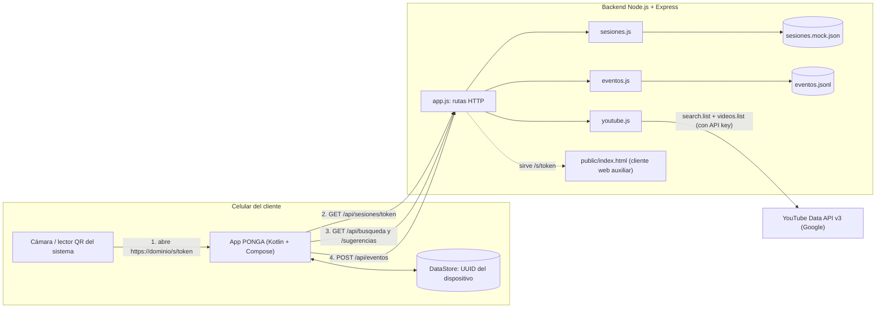
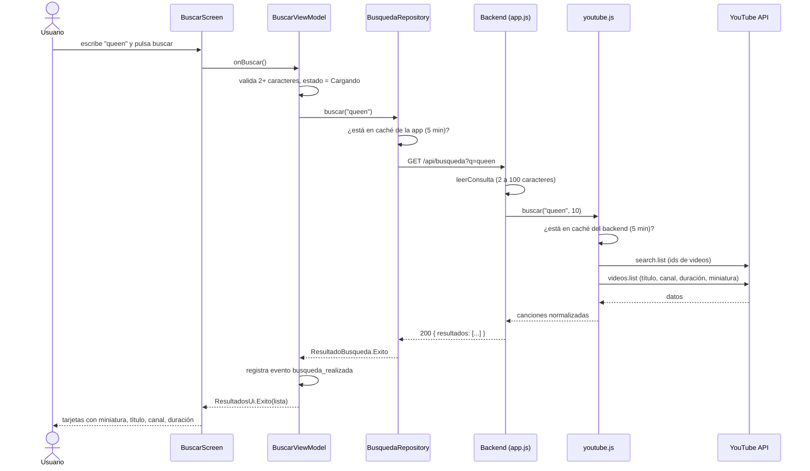
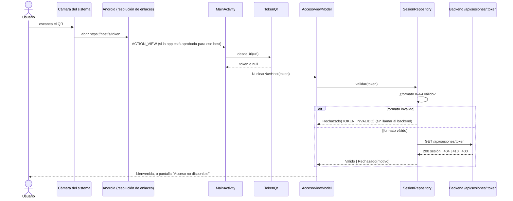
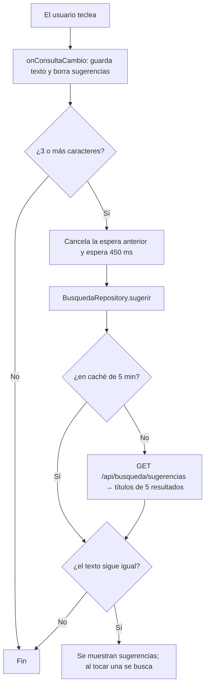
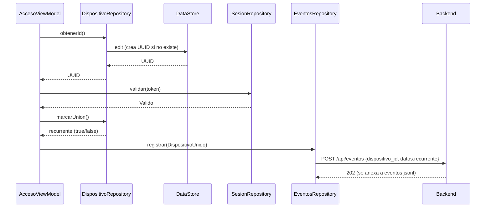
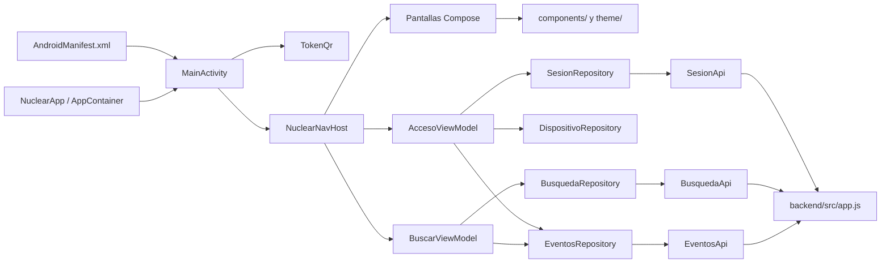
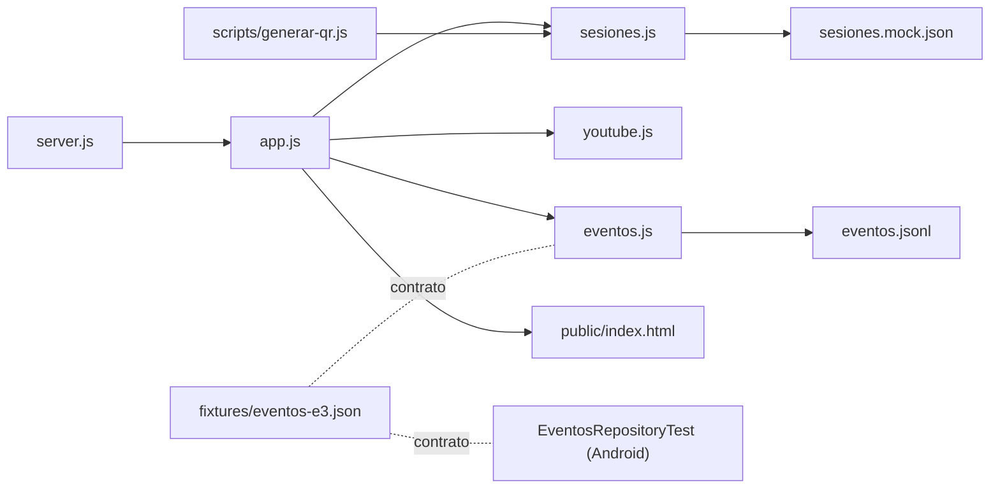
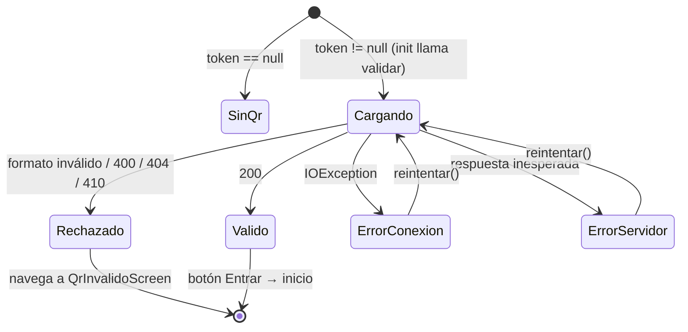
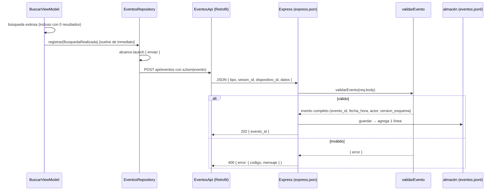

# Proyecto Nuclear VII — Guía de estudio del código (Entregable 3)

> **Qué es este documento.** Una explicación del código real del repositorio `proyecto-nuclear-vii`, escrita para que cualquier integrante del equipo pueda estudiarlo, exponerlo y mantenerlo.
> **Base de la explicación.** Todo lo que aquí se afirma sale de leer los archivos del repositorio. El backend y la capa de datos de Android se leyeron el 2026-11-06 (rama `develop`); la **interfaz de Android** se actualizó el 2026-11-07 contra el código del rediseño visual (rama `feature/redisenio-ux-ui`, cambios todavía sin commit). Cuando algo no se pudo comprobar, se dice.
> **Seguridad.** No se incluye ninguna clave, token real ni UUID de dispositivos reales. Los tokens `demo-…` son datos de prueba del archivo `sesiones.mock.json`; los UUID de ejemplo son inventados.

**Abreviatura de rutas.** Para no repetir rutas larguísimas, en este documento `<KT>` significa:

```
cliente-android/app/src/main/java/co/edu/cue/nuclear/cliente
```

---

## Índice

1. [Introducción al Proyecto Nuclear](#1-introducción-al-proyecto-nuclear)
2. [Arquitectura general](#2-arquitectura-general-del-sistema)
3. [Estructura de carpetas y archivos](#3-estructura-completa-de-carpetas-y-archivos)
4. [Backend (Node.js + Express)](#4-documentación-del-backend)
5. [Android y Kotlin](#5-documentación-de-android-y-kotlin)
6. [Integración Android ↔ backend](#6-integración-entre-android-y-backend)
7. [Integración con YouTube](#7-integración-con-youtube)
8. [QR y sesiones](#8-funcionamiento-del-qr-y-las-sesiones)
9. [Identificación del dispositivo](#9-identificación-única-del-dispositivo)
10. [Modelos de datos](#10-modelos-de-datos-y-estructuras)
11. [Configuración y dependencias](#11-configuración-y-dependencias)
12. [Manejo de errores](#12-manejo-de-errores)
13. [Flujos completos](#13-flujos-completos-del-sistema)
14. [Relación entre archivos](#14-relación-entre-archivos)
15. [Glosario](#15-glosario)
**Anexos A–K** (profundización: código anotado, pruebas, CI, mantenimiento, guion de exposición): ver [Anexos de profundización](#anexos-de-profundización-revisión-crítica-de-esta-guía)
16. [Preguntas de estudio](#16-preguntas-de-estudio) (las respuestas están al final, separadas)
17. [Resumen de verificación, límites y archivos a revisar con el equipo](#17-resumen-de-verificación-límites-y-archivos-a-revisar)

---

# 1. Introducción al Proyecto Nuclear

## 1.1. Qué es y qué problema resuelve

**Proyecto Nuclear VII** (la app se llama **PONGA**) es un proyecto universitario de Ingeniería de Software. Su idea: en un establecimiento (bar, café) la música la suele decidir una sola persona. El sistema busca que **los clientes participen**: escanean un código QR, buscan una canción y (en entregables posteriores) la solicitan y votan.

## 1.2. Usuarios

| Usuario | Qué hace | ¿Existe en el código actual? |
|---|---|---|
| **Cliente** | Escanea el QR, busca canciones, ve su información | **Sí** (app Android) |
| **Administrador / DJ** | Gestiona sesiones, cola, reproducción | **No.** No hay panel web de administración en el repositorio |
| **Equipo de analítica** | Consume eventos de uso | **Parcial:** solo se guardan eventos en un archivo local; no hay pipeline |

## 1.3. Alcance real de este repositorio (Entregable 3)

El repositorio implementa **únicamente** el módulo de acceso y búsqueda para clientes. Estas son las historias de usuario cubiertas:

| Historia | Qué pide | Estado en el código |
|---|---|---|
| B01 | Acceso mediante QR | **Parcial:** la app abre el enlace del QR y lo valida con el backend, pero las sesiones son **simuladas** (MOCK) y la verificación de dominio de App Links no se logró con un dominio real |
| B02 | Acceso sin registro ni descarga | **Parcial:** sin registro sí (no se pide ningún dato). Sobre "sin descarga": el cliente nativo exige tener la app instalada; existe además un cliente web auxiliar en `backend/public/` |
| B07 | Identificación única del dispositivo | **Implementada** (UUID aleatorio guardado en DataStore) |
| B03 | Búsqueda de canciones | **Implementada** (vía backend → YouTube) |
| B04 | Autocompletado | **Implementada** (sugerencias remotas con espera de 450 ms) |
| B05 | Información y miniaturas | **Implementada** (título, canal, duración, miniatura, disponibilidad) |
| B16 | Integración con YouTube | **Implementada** en el backend (existe una prueba contra YouTube real, `backend/test-real/youtube.real.js`, que depende de la clave local; los resultados de esa verificación constan en los informes del equipo y no se reprodujeron aquí) |

**Lo que NO existe todavía** (no lo busques en el código): solicitar canciones, votar, cola de reproducción, vista pública de la cola, panel de administración/DJ, reproducción de video, base de datos, pipeline de Big Data, inicio de sesión de cualquier tipo.

## 1.4. Cómo se ve desde el usuario

1. La persona abre la cámara del celular y escanea el QR pegado en la mesa.
2. El QR contiene una dirección web (`https://<dominio>/s/<token>`). El sistema Android la entrega a la app PONGA (si está instalada y aprobada para ese dominio).
3. La app pregunta al backend si ese token pertenece a una sesión activa.
4. Si es válida: pantalla de bienvenida con el nombre del establecimiento → "Entrar" → inicio → "Buscar una canción" (o tocar el campo de búsqueda de inicio, que lleva al mismo lugar).
5. Al escribir, aparecen sugerencias; mientras se busca se ven filas "esqueleto"; al terminar aparecen resultados con miniatura (y la duración encima), título y canal; al tocar uno se ve el detalle, con una flecha para volver a los resultados.
6. Si no es válida: pantalla "Acceso no disponible" con el motivo.

## 1.5. Componentes tecnológicos

| Componente | Tecnología | Carpeta |
|---|---|---|
| App cliente | Kotlin + Jetpack Compose (Android nativo) | `cliente-android/` |
| Backend | Node.js 20 + Express 4 | `backend/` |
| Cliente web auxiliar | HTML + JavaScript puro | `backend/public/index.html` |
| Servicio externo | YouTube Data API v3 | (se consume desde `backend/src/youtube.js`) |
| Automatización | GitHub Actions | `.github/workflows/` |
| Documentación | Markdown | `docs/entregable-3/` |

---

# 2. Arquitectura general del sistema

## 2.1. Diagrama



## 2.2. Explicación de cada conexión

1. **Cámara → App.** El QR solo contiene una URL `https`. La app no tiene lector de QR propio: lo hace el sistema (o la app de cámara) y Android entrega la URL a PONGA gracias a un *intent-filter* declarado en `AndroidManifest.xml`.
2. **App → backend (sesión).** La app envía el token del QR para saber si la sesión existe y está activa. El backend consulta `sesiones.mock.json` (datos simulados).
3. **App → backend (búsqueda).** La app **nunca** habla con YouTube. Le pide al backend, y el backend (que guarda la clave de API) habla con YouTube.
4. **App → backend (eventos).** La app avisa "un dispositivo se unió" y "se hizo una búsqueda". El backend los anexa a `backend/data/eventos.jsonl`.
5. **Backend → YouTube.** Dos llamadas por búsqueda: `search.list` (encuentra videos) y `videos.list` (trae duración y datos completos).
6. **Cliente web auxiliar.** Si el navegador abre `/s/<token>`, el backend devuelve `index.html`, que repite el flujo (validar → buscar) con JavaScript. No es el cliente oficial (según la aclaración del docente el cliente es la app nativa).

> **No hay base de datos.** Las sesiones están en un JSON de ejemplo y los eventos en un archivo de texto. Tampoco hay panel de administración.

---

# 3. Estructura completa de carpetas y archivos

## 3.1. Resumen

| Archivo o carpeta | Ubicación | Responsabilidad | Relación |
|---|---|---|---|
| `backend/` | raíz | Servidor Node/Express | Lo consume la app y el cliente web |
| `cliente-android/` | raíz | Proyecto Android (Kotlin) | Consume el backend |
| `docs/entregable-3/` | raíz | Informes de incrementos, trazabilidad, CI | Documenta lo anterior |
| `.github/workflows/` | raíz | CI (`android.yml`, `backend.yml`) | Compila y prueba ambos |
| `README.md` | raíz | Descripción en 2 líneas | — |
| `.gitignore`, `.gitattributes` | raíz | Qué no se versiona; fin de línea | Protege `.env` y `eventos.jsonl` |
| `CLAUDE.md`, `CONTRIBUTING.md`, PDFs, `docs/diseño-ui`, `docs/logo` | raíz/`docs` | Contexto del equipo y recursos de diseño | **Sin versionar** en Git al momento de esta revisión |

## 3.2. Carpeta `backend/`

| Archivo | Para qué existe | Si no existiera |
|---|---|---|
| `package.json` | Declara nombre, scripts (`start`, `test`, `test:real`, `qr`) y dependencias (`express`, `dotenv`, `qrcode`) | No se podría instalar ni arrancar |
| `package-lock.json` | Fija las versiones exactas instaladas por `npm ci` | Instalaciones no reproducibles |
| `.env.example` | Plantilla de configuración (sin valores secretos) | Nadie sabría qué variables definir |
| `.env` (local, **no versionado**) | Contiene la clave real de YouTube | El endpoint de búsqueda respondería 503 |
| `src/server.js` | **Punto de entrada.** Lee `.env`, arma las piezas y abre el puerto | No arranca el servidor |
| `src/app.js` | Define las rutas HTTP (la "recepción" del backend) | No habría endpoints |
| `src/sesiones.js` | Carga sesiones y valida el token del QR | No se podría validar el acceso |
| `src/youtube.js` | Cliente de YouTube: busca, une datos, traduce errores, guarda caché | No habría búsqueda |
| `src/eventos.js` | Valida eventos y los guarda en JSONL | No habría instrumentación |
| `data/sesiones.mock.json` | Tres sesiones **ficticias** | `cargarSesiones()` fallaría |
| `public/index.html` | Cliente web auxiliar | `/s/<token>` no devolvería página |
| `public/ponga-logo.png` | Logo que usa esa página | La página mostraría el logo roto |
| `scripts/generar-qr.js` | Genera la imagen PNG del QR de una sesión | Habría que crear los QR a mano |
| `test/backend.test.js`, `test/contrato-eventos.test.js`, `test/fixtures/eventos-e3.json` | Pruebas automáticas y contrato de eventos compartido con Android | Sin red de seguridad |
| `test-real/youtube.real.js` | Prueba contra YouTube **real** (consume cuota; no entra en `npm test`) | Solo habría pruebas simuladas |

## 3.3. Carpeta `cliente-android/`

| Ruta | Responsabilidad |
|---|---|
| `settings.gradle.kts`, `build.gradle.kts`, `gradle.properties`, `gradle/libs.versions.toml`, `gradle/wrapper/*`, `gradlew(.bat)` | Configuración y versiones del build (ver sección 11) |
| `app/build.gradle.kts` | Configuración del módulo: SDK, dependencias, URL del backend, host de App Links |
| `app/src/main/AndroidManifest.xml` | Declara la app: permiso de internet, actividad, filtros de enlaces |
| `app/src/main/res/` | Recursos: logo (`drawable-nodpi/ponga_logo.png`), nueve iconos vectoriales (`drawable/ic_*.xml`), fuente `font/manrope.ttf`, textos, tema, seguridad de red |
| `app/src/debug/res/xml/network_security_config.xml` | Solo en *debug*: permite HTTP para el backend local |
| `<KT>/MainActivity.kt`, `NuclearApp.kt` | Arranque y contenedor de dependencias |
| `<KT>/data/` | **Capa de datos**: llamadas al backend, caché, DataStore, eventos |
| `<KT>/ui/` | **Capa de interfaz**: navegación, pantallas, componentes, tema |
| `app/src/test/` | 86 pruebas unitarias (contadas por anotación `@Test`) |

Árbol de `<KT>`:

```
cliente/
├── MainActivity.kt        ← única Activity; recibe el enlace del QR
├── NuclearApp.kt          ← Application + AppContainer (dependencias)
├── data/
│   ├── RedModule.kt       ← crea Retrofit/OkHttp
│   ├── sesion/            ← TokenQr, SesionApi, SesionRepository, ResultadoAcceso, SesionActiva
│   ├── dispositivo/       ← DispositivoRepository (UUID)
│   ├── busqueda/          ← BusquedaApi, BusquedaRepository, Cancion
│   └── eventos/           ← Evento, EventosApi, EventosRepository
└── ui/
    ├── navigation/        ← Destinos, NuclearNavHost
    ├── screens/           ← acceso, buscar, detalle, inicio (+ PantallaProvisional)
    ├── components/        ← NuclearScreen, Brand, Componentes, CampoBusqueda, CancionItem, Esqueleto,
    │                        EstadoVacio, BarraSuperior, NuclearIcon, Animaciones (+ archivos *Preview)
    └── theme/             ← Color, Type, Theme, Dimens, Motion
```

Los detalles archivo por archivo están en las secciones 4 (backend) y 5 (Android).

---

# 4. Documentación del backend

## 4.1. ¿Qué es el backend en nuestro proyecto?

**Concepto técnico — backend:** programa que corre en un servidor y atiende peticiones de otros programas (clientes). No tiene pantalla; recibe una petición, hace trabajo y devuelve datos.

**¿Para qué sirve en nuestro proyecto?** Tres cosas: (1) decidir si un QR corresponde a una sesión válida, (2) hablar con YouTube **guardando la clave de API fuera del celular**, (3) recibir y guardar los eventos de uso.

**Ejemplo:** el celular pregunta `GET /api/sesiones/demo-activa-001`; el backend responde con el nombre del bar y el id de la sesión.

**Diferencia con la app Android:** la app es lo que el usuario ve y toca (Kotlin, corre en el celular). El backend es lo que no se ve (JavaScript/Node, corre en el computador del equipo). Que usen lenguajes distintos no importa porque se comunican con un formato común: **HTTP + JSON**. Cada lado solo necesita saber qué petición hacer y qué respuesta esperar (el "contrato").

**Archivo relacionado:** `backend/src/app.js`.

## 4.2. Estructura

Ver tabla de la sección 3.2. Capas reales del backend (no hay más):

```
server.js  →  crea y conecta  →  app.js (rutas)
                                    ├─ sesiones.js  (validación del token)
                                    ├─ youtube.js   (búsqueda)
                                    └─ eventos.js   (validación + archivo)
```

No hay controladores, servicios ni repositorios como carpetas separadas: son cuatro módulos pequeños. La técnica que sí se usa es la **inyección de dependencias**: `crearApp` recibe las piezas (`sesiones`, `youtube`, `almacenEventos`) como parámetros, para poder reemplazarlas por versiones falsas en las pruebas.

## 4.3. Análisis archivo por archivo

### 4.3.1. `backend/src/server.js` (23 líneas)

- **Propósito:** arrancar el servidor.
- **Qué hace, paso a paso:**
  1. `require('dotenv').config({ path: ... '../.env' })` — carga las variables de `backend/.env` en `process.env`.
  2. Importa `crearApp`, `cargarSesiones`, `crearClienteYoutube`, `crearAlmacen`.
  3. `const port = Number(process.env.PORT) || 3000;` — usa el puerto del `.env` o 3000.
  4. Si falta `YOUTUBE_API_KEY`, imprime un aviso (no detiene el servidor).
  5. Llama `crearApp({...})` pasando las piezas reales.
  6. `app.listen(port, ...)` — empieza a escuchar.
- **Dependencias:** `dotenv`, los cuatro módulos propios.
- **Si no existiera:** nada arranca (`npm start` ejecuta este archivo).

### 4.3.2. `backend/src/app.js` (112 líneas)

- **Propósito:** definir **todos los endpoints**.
- **Función `crearApp({ sesiones, youtube, almacenEventos, config })`**
  - *Parámetros:* `sesiones` (lista de sesiones ya cargada), `youtube` (objeto con `buscar`), `almacenEventos` (objeto con `guardar`), `config` (paquete Android y huellas SHA-256 para App Links).
  - *Devuelve:* la aplicación Express (aún sin escuchar puerto).
  - *Internamente:* `express.json({ limit: '10kb' })` convierte cuerpos JSON en objetos y rechaza cuerpos enormes; `app.disable('x-powered-by')` oculta que es Express.
- **Funciones auxiliares internas**
  - `errorJson(res, status, codigo, mensaje)`: responde siempre con el mismo formato de error `{ "error": { "codigo": "...", "mensaje": "..." } }`.
  - `leerConsulta(req, res)`: toma `?q=`, le quita espacios y comprueba que tenga entre 2 (`MIN_Q`) y 100 (`MAX_Q`) caracteres. Si no, responde 400 `consulta_invalida` y devuelve `null`.
  - `manejarYoutube(res, err)`: si el error es un `YoutubeError` responde con su código y estado; si es otra cosa, 500 `error_interno`.
- **Constante `STATUS_POR_MOTIVO`:** traduce el motivo de rechazo del QR en código HTTP (400, 404, 410, 410).
- **Si no existiera:** no habría API.

### 4.3.3. `backend/src/sesiones.js` (31 líneas)

- **Propósito:** B01 — validar el token.
- `TOKEN_REGEX = /^[A-Za-z0-9_-]{8,64}$/`: el token debe tener 8 a 64 caracteres entre letras, números, `_` y `-`. Impide, por ejemplo, `../../etc/passwd`.
- `cargarSesiones(ruta)`: lee `data/sesiones.mock.json` y devuelve el arreglo `sesiones`. *Falla (lanza excepción)* si el archivo no existe o está mal formado.
- `validarToken(token, sesiones)`: devuelve `{ ok: true, sesion }` o `{ ok: false, motivo }`. Orden de comprobaciones:
  1. ¿Formato correcto? Si no → `token_invalido`.
  2. ¿Existe una sesión con ese `qr_token`? Si no → `sesion_inexistente`.
  3. ¿`estado === 'activa'`? Si no → `sesion_cerrada`.
  4. ¿`qr_estado === 'activo'`? Si no → `qr_desactivado`.
- **Importante:** la **validación es real**, pero la **fuente de datos es simulada**.

### 4.3.4. `backend/src/youtube.js` (123 líneas)

Se explica a fondo en la sección 7.

### 4.3.5. `backend/src/eventos.js` (60 líneas)

- **Propósito:** validar y guardar los dos eventos del E3.
- `validarEvento(body, ahora)`: revisa el cuerpo recibido y devuelve `{ evento }` o `{ error }`.
  - Acepta solo `tipo` = `dispositivo_unido` o `busqueda_realizada`.
  - Exige `sesion_id` (texto no vacío) y `dispositivo_id` con forma de UUID (`UUID_REGEX`).
  - `dispositivo_unido`: toma `datos.recurrente` (verdadero solo si es exactamente `true`).
  - `busqueda_realizada`: exige `datos.termino` no vacío y `datos.cantidad_resultados` entero ≥ 0; recorta el término a 100 caracteres; `desde_cache` verdadero solo si es `true`.
  - *Registro final:* añade `evento_id` (UUID nuevo generado por el servidor), `fecha_hora` (UTC), `actor: 'cliente'`, `version_esquema: '1.0'` y `datos_evento`.
- `crearAlmacen(ruta)`: devuelve un objeto con `guardar(evento)`, que crea la carpeta si falta y **agrega una línea JSON** a `data/eventos.jsonl` (formato JSON Lines: un objeto por línea).
- **Si no existiera:** no se registrarían eventos. Este archivo **no es** el pipeline de Big Data (eso corresponde a otro entregable y a Karen).

### 4.3.6. `backend/scripts/generar-qr.js` (27 líneas)

- Uso: `node scripts/generar-qr.js <token> [salida.png]` (también `npm run qr`).
- Valida el token con `TOKEN_REGEX`, toma `PUBLIC_BASE_URL` del `.env`, construye `base + '/s/' + token` y genera un PNG de 600 px con la librería `qrcode`. Avisa si la base no es HTTPS.

### 4.3.7. `backend/public/index.html` (136 líneas)

Cliente web auxiliar. Contiene HTML, estilos y un script que: extrae el token de la URL, llama `GET /api/sesiones/<token>`, muestra la pantalla de búsqueda, hace autocompletado (mínimo 3 caracteres, espera 450 ms), búsqueda y emite los dos eventos. Guarda un UUID propio en `localStorage`. Usa el logo `backend/public/ponga-logo.png` (logo de PONGA).

### 4.3.8. Scripts y pruebas

- `package.json` → `npm test` ejecuta `node --test test/` (ejecutor de pruebas incluido en Node, sin librerías extra).
- `backend.test.js` prueba validación de tokens, `parseDuracionIso`, `mapearCanciones`, el cliente YouTube con respuestas **simuladas**, y las rutas HTTP. **Estas pruebas no demuestran que YouTube real funcione**; para eso existe `test-real/youtube.real.js`.
- `contrato-eventos.test.js` + `fixtures/eventos-e3.json`: el mismo archivo JSON lo usa Android (`EventosRepositoryTest`) para asegurarse de que ambos lados hablan igual.

## 4.4. Funciones relevantes (resumen consolidado)

| Función | Archivo | Entrada | Salida | Quién la llama |
|---|---|---|---|---|
| `crearApp` | app.js | dependencias | app Express | server.js, pruebas |
| `validarToken` | sesiones.js | token, lista de sesiones | `{ok, sesion}` o `{ok:false, motivo}` | ruta de sesiones |
| `cargarSesiones` | sesiones.js | ruta (opcional) | arreglo de sesiones | server.js |
| `buscar` | youtube.js | texto `q`, `maxResults` | arreglo de canciones | rutas de búsqueda/sugerencias |
| `parseDuracionIso` | youtube.js | `"PT3M10S"` | segundos (`190`) o `null` | `mapearCanciones` |
| `mapearCanciones` | youtube.js | resultados de search + videos | canciones normalizadas | `buscar` |
| `clasificarError` | youtube.js | status HTTP, cuerpo | `YoutubeError` | `getJson` |
| `validarEvento` | eventos.js | cuerpo recibido | `{evento}` o `{error}` | ruta de eventos |
| `crearAlmacen().guardar` | eventos.js | evento | (escribe una línea) | ruta de eventos |

## 4.5. Endpoints

Todos los ejemplos usan datos de prueba.

### `GET /api/sesiones/:token` — `backend/src/app.js`

- **Hace:** valida el QR (B01).
- **Recibe:** el token en la ruta.
- **Éxito (200):**
  ```json
  { "id_sesion": "SES-MOCK-001",
    "establecimiento": { "id_establecimiento": "EST-MOCK-001", "nombre": "La Nota Bar (demo)" },
    "estado": "activa", "provisional": true }
  ```
- **Errores:** `400 token_invalido`, `404 sesion_inexistente`, `410 sesion_cerrada`, `410 qr_desactivado`. Cuerpo: `{ "error": { "codigo": "sesion_inexistente", "mensaje": "Acceso no disponible para este código QR." } }`.
- **Consume:** app Android (`SesionApi`) y cliente web.

### `GET /api/busqueda?q=...`

- **Hace:** devuelve hasta 10 canciones (B03, B05, B16).
- **Recibe:** `q` (2 a 100 caracteres).
- **Éxito (200):**
  ```json
  { "resultados": [ { "youtube_video_id": "AAAAAAAAAAA", "titulo": "Canción de ejemplo",
      "artista_canal": "Canal de ejemplo", "duracion_segundos": 190,
      "url_miniatura": "https://i.ytimg.com/vi/AAAAAAAAAAA/mqdefault.jpg", "disponibilidad": "disponible" } ] }
  ```
- **Errores:** `400 consulta_invalida`; `503 sin_api_key | api_key_invalida | youtube_no_autorizado | cuota_excedida`; `502 youtube_error | youtube_no_disponible`; `500 error_interno`.

### `GET /api/busqueda/sugerencias?q=...`

- **Hace:** autocompletado (B04). Busca hasta 5 canciones y devuelve sus **títulos sin repetir**: `{ "sugerencias": ["Título 1", "Título 2"] }`. Mismos errores que la búsqueda.

### `POST /api/eventos`

- **Recibe (cuerpo JSON):**
  ```json
  { "tipo": "busqueda_realizada", "sesion_id": "SES-MOCK-001",
    "dispositivo_id": "11111111-2222-4333-8444-555555555555",
    "datos": { "termino": "ejemplo", "cantidad_resultados": 10, "desde_cache": false } }
  ```
- **Éxito:** `202 Accepted` con `{ "evento_id": "<uuid generado por el servidor>" }` ("aceptado", se guardó).
- **Errores:** `400` con códigos como `tipo_no_soportado`, `sesion_id_requerido`, `dispositivo_id_invalido`, `termino_requerido`, `cantidad_resultados_invalida`, `cuerpo_invalido`. (Un JSON mal formado lo rechaza Express antes de llegar a la ruta.)

### `GET /.well-known/assetlinks.json`

- **Hace:** publica la relación "este dominio ↔ esta app Android" que Android consulta para verificar App Links. Usa `ANDROID_PACKAGE` y `ANDROID_SHA256_CERT` (lista separada por comas). **Si no se configuró la huella, la lista queda vacía y la verificación no puede tener éxito.**

### `GET /s/:token` y archivos estáticos

- Devuelve `public/index.html` (cliente web auxiliar). `express.static` sirve el resto de `public/`.

## 4.6. Flujo interno de una solicitud

```
Petición HTTP → Express (express.json) → ruta en app.js
  → (validación: leerConsulta / validarToken / validarEvento)
  → lógica: youtube.buscar / almacenEventos.guardar
  → res.json(...) con código HTTP
```

Ejemplo `GET /api/busqueda?q=queen`: `leerConsulta` valida → `youtube.buscar('queen', 10)` → (revisa caché; si no hay, llama a YouTube dos veces) → `res.json({ resultados })`. Si algo lanza un `YoutubeError`, `manejarYoutube` lo traduce a un JSON de error.

---

# 5. Documentación de Android y Kotlin

## 5.1. Conceptos, ligados a archivos reales

**Kotlin.** Lenguaje oficial de Android; todo el código de `<KT>` está en Kotlin.

**Jetpack Compose.** Forma moderna de dibujar pantallas escribiendo funciones en vez de archivos XML. *Ejemplo:* `InicioScreen` en `<KT>/ui/screens/inicio/InicioScreen.kt`.

**Composable.** Función marcada con `@Composable` que describe un trozo de interfaz. *¿Para qué?* Componer pantallas con piezas reutilizables: `BotonPrincipal`, `Insignia`, `CancionItem`.

**Modifier.** Lista de "ajustes" que se encadenan a un elemento (tamaño, margen, fondo, clic). *Ejemplo:* `Modifier.fillMaxWidth().heightIn(min = 52.dp)` en `BotonPrincipal`.

**Activity.** Ventana/entrada de una app Android. PONGA tiene una sola: `MainActivity`.

**Estado (State).** Datos que, al cambiar, hacen que Compose vuelva a dibujar. *Ejemplo:* `BuscarUiState` (consulta, sugerencias, resultados).

**ViewModel.** Objeto que guarda el estado de una pantalla y sobrevive a rotaciones. *Ejemplo:* `AccesoViewModel`, `BuscarViewModel`.

**StateFlow.** Contenedor observable de un valor; el ViewModel lo expone y la pantalla lo observa con `collectAsState()`.

**Corrutina.** Forma de hacer tareas lentas (red, disco) sin congelar la pantalla. Las funciones `suspend` pueden pausarse. *Ejemplo:* `suspend fun buscar(...)` en `BusquedaRepository`; `viewModelScope.launch { ... }` en los ViewModel.

**DataStore.** Almacenamiento local clave-valor y asíncrono. *Ejemplo:* guarda el UUID del dispositivo.

**Retrofit.** Librería que convierte una interfaz Kotlin en llamadas HTTP. *Ejemplo:* `SesionApi.obtener(token)` hace `GET api/sesiones/{token}`.

**Repositorio.** Clase que esconde de dónde vienen los datos (red, caché, disco). *Ejemplo:* `BusquedaRepository`.

**Coil.** Librería que descarga y muestra imágenes por URL; aquí se usa `SubcomposeAsyncImage` (en `MiniaturaCancion`) porque permite dibujar un contenido distinto mientras carga o si falla.

**Material 3.** Conjunto de componentes y reglas de diseño de Google que Compose trae listo. PONGA lo usa como base (por ejemplo `Button`, `MaterialTheme`) pero con los colores, la fuente y las formas del diseño del equipo.

**Token de diseño.** Un valor con nombre (un espaciado, un tamaño de icono, una duración de animación) que se define una sola vez y se reutiliza. *Ejemplos:* `NuclearSpacing.Lg`, `NuclearLayout.ContentMaxWidth`, `NuclearMotion.ENTRADA_MS`. Así, cambiar un valor cambia toda la app y el diseño se mantiene consistente.

**CompositionLocal.** Forma de "pasar un dato hacia abajo" por todo el árbol de composables sin ponerlo como parámetro en cada función. *Ejemplo:* `LocalFondoGlobal`, que le avisa a `NuclearScreen` si el fondo ya lo dibuja `MainActivity`.

**Semántica (accesibilidad).** Información que Compose publica para los lectores de pantalla (TalkBack): qué es un encabezado, qué texto se anuncia solo, cómo se llama un botón sin texto. *Ejemplo:* `semantics { heading() }` en los títulos de pantalla.

## 5.2. Estructura del módulo y patrón general

El código sigue tres capas sencillas:

```
Pantalla (Composable)  ←observa estado—  ViewModel  —llama→  Repositorio  —llama→  Api (Retrofit) → backend
```

- **Pantalla:** solo dibuja y reenvía eventos (`onBuscar`, `onCancion`).
- **ViewModel:** decide qué estado mostrar.
- **Repositorio:** traduce respuestas del backend a modelos propios y manejo de errores.

No se usa un framework de inyección de dependencias (Hilt, Koin): `AppContainer` en `NuclearApp.kt` crea todo a mano porque "el alcance no lo justifica" (comentario del código).

## 5.3. Arranque de la app

### `AndroidManifest.xml` (43 líneas)
- Permiso `INTERNET` (el único).
- `android:name=".NuclearApp"`: clase `Application` propia.
- `allowBackup="false"`: el sistema no respalda los datos de la app (el UUID no se restaura en otro equipo).
- `networkSecurityConfig`: política de red (en *debug* permite HTTP).
- `MainActivity` con `exported="true"` y **dos filtros**:
  - `MAIN/LAUNCHER`: icono del menú de apps.
  - `VIEW` + `DEFAULT` + `BROWSABLE` + datos `https`, host `${appLinkHost}`, `pathPrefix="/s/"`, con `autoVerify="true"`: **este es el filtro del QR**. `${appLinkHost}` se reemplaza en compilación por el valor de Gradle (por defecto `nuclear.example.com`, un dominio de ejemplo).
- `launchMode="singleTop"`: si la app ya está abierta, un nuevo enlace llega a `onNewIntent` en vez de abrir otra ventana.

### `MainActivity.kt`
- `onCreate`: activa pantalla completa (`enableEdgeToEdge`), lee el token del intent (`tokenDesde`), obtiene el contenedor de dependencias y dibuja, dentro de `NuclearTheme` y un `Surface`, un `Box` con el fondo de la app (`fondoNuclear()`: canvas oscuro con un degradado violeta suave) que cubre **toda la ventana**, incluso bajo la barra de estado y la de navegación. Dentro va `NuclearNavHost` con `Modifier.safeDrawingPadding()`: el fondo llega a los bordes, pero el contenido respeta las zonas seguras del sistema. `CompositionLocalProvider(LocalFondoGlobal provides true)` avisa a las pantallas de que el fondo ya está dibujado.
- `key(tokenQr) { ... }`: si llega un token **distinto**, Compose destruye y recrea la navegación, reiniciando el flujo de acceso.
- `onNewIntent`: si llega otro enlace con la app abierta, actualiza `tokenQr`.
- `tokenDesde(intent)`: solo si `intent.action == ACTION_VIEW` llama a `TokenQr.desdeUrl(intent.dataString)`; si no, `null`.

### `NuclearApp.kt`
- `NuclearApp : Application`: `contenedor` se crea de forma perezosa (`by lazy`).
- `AppContainer(contexto)`: crea `DispositivoRepository` (con el DataStore llamado `"dispositivo"`), un solo `Retrofit` con `BuildConfig.BACKEND_URL`, y de él `SesionRepository`, `BusquedaRepository` y `EventosRepository`. También `SesionActivaStore` (memoria). Los eventos usan su propio `CoroutineScope(SupervisorJob() + Dispatchers.IO)` para que un cambio de pantalla no los cancele.

### `data/RedModule.kt`
- `crearRetrofit(baseUrl)`: OkHttp con tiempo de conexión de 10 s y de lectura de 15 s (la búsqueda encadena dos llamadas a YouTube en el backend); convertidor `kotlinx.serialization` con `ignoreUnknownKeys = true` (si el backend agrega campos nuevos, la app no se rompe).
- `crearSesionApi/BusquedaApi/EventosApi`: atajos; `AppContainer` no los usa (llama a `crearRetrofit` directamente).

## 5.4. Navegación

### `ui/navigation/Destinos.kt`
Constantes de rutas: `acceso`, `qr-invalido/{motivo}`, `inicio`, `buscar`, `detalle/{videoId}` y dos funciones que arman la ruta con el argumento (`detalle(id)`, `qrInvalido(motivo)`).

### `ui/navigation/NuclearNavHost.kt`
Mapa de pantallas con `NavHost`, destino inicial `acceso`.

| Ruta | Qué muestra | Cómo se llega |
|---|---|---|
| `acceso` | `AccesoScreen` | Inicio de la app |
| `qr-invalido/{motivo}` | `QrInvalidoScreen` | Automático si el QR fue rechazado (`popUpTo(ACCESO){inclusive=true}` borra `acceso` del historial) |
| `inicio` | `InicioScreen` | Botón "Entrar" |
| `buscar` | `BuscarScreen` | Botón "Buscar una canción" |
| `detalle/{videoId}` | `DetalleScreen` | Tocar un resultado |

El ViewModel de acceso se crea con `viewModel(key = "acceso-$token")`: un token distinto produce un ViewModel nuevo.

**Transiciones entre pantallas.** `NuclearNavHost` también define cómo se animan los cambios de pantalla (solo parte visual: las rutas y la pila de navegación no cambian). La pantalla que entra aparece con un fundido de 220 ms y un desplazamiento horizontal de 24 dp; la que sale se desvanece en 120 ms; al volver atrás el desplazamiento va en sentido contrario. De `acceso` hacia `inicio` o `qr-invalido` solo hay fundido, sin desplazamiento. Si el sistema tiene las animaciones desactivadas, el cambio es instantáneo (ver 5.11). Los tiempos salen de `NuclearMotion` (`ui/theme/Motion.kt`).

## 5.5. Pantallas

### Pantalla de acceso — `ui/screens/acceso/AccesoScreen.kt` + `AccesoViewModel.kt`
1. **Qué muestra:** según `AccesoEstado`, dentro de `NuclearScreen` (marca arriba, contenido centrado y la acción principal anclada abajo, a la altura del pulgar): cargando (indicador circular y "Validando el código QR…"), sin QR (símbolo de QR y "Escanea el código QR"), sin conexión o error del servidor (símbolo en tono de aviso/peligro, mensaje y botón "Reintentar"), o válido (símbolo de QR, insignia "Acceso mediante QR", el título "La música también la eliges tú.", el nombre del establecimiento en un `ChipEstablecimiento`, una insignia de aviso "Sesión de prueba…" si `provisional`, y abajo el botón "Entrar" con la nota de privacidad "Sin nombre, correo ni datos personales."). Los bloques aparecen de forma escalonada con `Modifier.aparicion(orden)`.
2. **Qué necesita:** el token (puede ser `null`).
3. **Cómo lo obtiene:** `MainActivity` → `NuclearNavHost` → constructor del ViewModel.
4. **ViewModel:** estado inicial `SinQr` (token null) o `Cargando`. En `init`, si hay token llama `validar()`.
5. **`validar()`:** (a) `dispositivos.obtenerId()` — garantiza el UUID; (b) `sesiones.validar(token)`; (c) `.aEstado(dispositivoId)` convierte el resultado; (d) si es válido, `registrarUnion`: guarda la sesión activa en memoria, calcula `recurrente` con `marcarUnion()` y registra `DispositivoUnido`; (e) publica el estado.
6. **Acciones del usuario:** "Entrar" (navega a inicio), "Reintentar" (vuelve a `Cargando` y valida otra vez).
7. **Observación:** el UUID se crea **antes** de validar el token, así que se genera aunque el QR sea rechazado (siempre que haya un token en el enlace).

### Pantalla de QR inválido — `QrInvalidoScreen.kt`
Dentro de `NuclearScreen`: un `SimboloIcono` con el icono de QR en tono de peligro, el título "Acceso no disponible" (neutro, no rojo; marcado como encabezado), `mensajeRechazo(motivo)` y la ayuda "Escanea de nuevo el código QR del establecimiento o pide ayuda al personal." Los textos por motivo son:

| Motivo | Texto |
|---|---|
| `TOKEN_INVALIDO` | El código QR no es válido. |
| `SESION_INEXISTENTE` | No pudimos identificar el establecimiento. |
| `SESION_CERRADA` | La sesión de este establecimiento ya terminó. |
| `QR_DESACTIVADO` | Este código QR está desactivado en este momento. |

No ofrece botones (el usuario debe escanear de nuevo).

### Pantalla de inicio — `InicioScreen.kt`
Marca arriba; en el centro un `SimboloIcono` de música, el título "¿Qué quieres escuchar?" y "Busca por canción, artista o canal."; abajo, en la zona del pulgar, una entrada con aspecto de campo de búsqueda (`EntradaBusqueda`, función privada de este archivo, con el texto "Canción, artista o canal") y el botón "Buscar una canción". **La entrada no se puede escribir**: es solo un acceso a Buscar, igual que el botón (ambos llaman a `onBuscar`); para el lector de pantalla es un botón. Es una versión reducida de la pantalla de Figma: "Ahora suena" y "Mi solicitud" pertenecen a entregables posteriores.

### Pantalla de búsqueda — `BuscarScreen.kt` + `BuscarViewModel.kt` + `MensajeError.kt`
- **Pantalla:** título "Busca una canción", un `CampoBusqueda` (lupa, texto, botón ✕ "Limpiar búsqueda" cuando hay texto, tecla "buscar" del teclado) y debajo la zona de resultados. El foco y el teclado se piden solo si la consulta está vacía (al volver desde el detalle ya hay una consulta y el teclado no reaparece). Si hay sugerencias, `ListaSugerencias` las dibuja **encima** de la zona de resultados como un menú desplegable, con scroll propio si son más de las que caben. La zona de resultados cambia según `ResultadosUi`, con un fundido entre estados (`AnimatedContent`, etiqueta `estados-buscar`):
  - `Inicial`: `EstadoVacio` con lupa y "Escribe el nombre de una canción o artista para empezar."
  - `Cargando`: el texto "Buscando…" (anunciado a los lectores de pantalla) y `ListaEsqueleto`: cuatro filas con la forma de un resultado y un brillo suave. **Ya no hay indicador circular en Buscar.**
  - `SinResultados`: `EstadoVacio` neutro con "No encontramos resultados para “…”. Prueba con otras palabras."
  - `Error`: `ErrorBusqueda` → `EstadoVacio` con icono y tono según el tipo de error (por ejemplo, wifi tachado en aviso para `CONEXION`, reloj para `CUOTA`) y el botón "Reintentar" solo si `reintentable`.
  - `Exito`: `LazyColumn` de `CancionItem`.
- **ViewModel — funciones:**
  - `onConsultaCambio(texto)`: actualiza el texto, borra sugerencias y cancela la espera anterior; **si la consulta queda vacía (solo espacios cuenta como vacía), también cancela una búsqueda en curso y vuelve a `ResultadosUi.Inicial`** (así, al pulsar ✕ no reaparecen resultados viejos); si hay menos de 3 caracteres no hace nada más; si no, lanza una tarea que **espera 450 ms** (`delay`) y consulta `sugerir`. Descarta la respuesta si el usuario ya cambió el texto. Editar el texto sin vaciarlo conserva los resultados que ya se veían.
  - `elegirSugerencia(s)`: pone el texto de la sugerencia y busca.
  - `buscar()`: exige 2+ caracteres, cancela tareas previas, muestra `Cargando`, llama a `repositorio.buscar`, registra el evento si fue exitoso (incluso con 0 resultados) y publica `Exito`/`SinResultados`/`Error`.
  - `reintentar()`: vuelve a llamar `buscar()`.
  - `registrarBusqueda`: crea `Evento.BusquedaRealizada` solo si hay `sesionActiva`.
- **`aMensaje()`** (MensajeError.kt) convierte `TipoErrorBusqueda` en título/detalle/`reintentable`.

### Pantalla de detalle — `ui/screens/detalle/DetalleScreen.kt`
Recibe una `Cancion?`. Arriba lleva una `BarraSuperior` con la flecha de volver (etiqueta accesible "Volver a resultados"); la flecha usa el mismo retroceso que el gesto del sistema (el despachador de "atrás" de la actividad), así que no hace falta una ruta nueva. Si la canción es `null` muestra un `EstadoVacio` "Canción no encontrada"; si no, la miniatura 16:9 con borde, el título (encabezado), el canal y una fila de insignias: "Duración m:ss" (neutra) y "Disponible para reproducir" (éxito) o "No disponible" (aviso). **El ID de YouTube ya no se muestra al cliente**: sigue siendo la clave interna para navegar y buscar la canción, pero no se dibuja. Obtiene la canción con `contenedor.busqueda.cancionPorId(id)` (caché en memoria). El ancho máximo de 560 dp ya no es un ajuste propio del detalle: lo aplica `NuclearScreen` a **todas** las pantallas.

### `PantallaProvisional.kt`
Resto del andamiaje inicial. En `NuclearNavHost` no se usa (no se encontró ninguna referencia en la navegación).

## 5.6. Componentes y tema

Todo lo reutilizable vive en `<KT>/ui/components/` (componentes) y `<KT>/ui/theme/` (valores de diseño). Las pantallas se arman con estas piezas en lugar de repetir código.

| Archivo | Qué contiene |
|---|---|
| `NuclearScreen.kt` | `NuclearScreen` (andamiaje común de las pantallas), `Modifier.fondoNuclear()` y `LocalFondoGlobal` |
| `Brand.kt` | `Brand`: el logo oficial con un resplandor violeta |
| `Componentes.kt` | `BotonPrincipal`, `TonoVisual`, `Insignia`, `SimboloIcono`, `ChipEstablecimiento` |
| `CampoBusqueda.kt` | `CampoBusqueda` y `ListaSugerencias` |
| `CancionItem.kt` | `CancionItem`, `MiniaturaCancion` (y, privados, `ChipDuracion` y `MarcadorMiniatura`) |
| `Esqueleto.kt` | `CancionItemEsqueleto` y `ListaEsqueleto` (filas "fantasma" de carga) |
| `EstadoVacio.kt` | `EstadoVacio`: icono, mensaje y acción opcional para estados sin contenido o con error |
| `BarraSuperior.kt` | `BarraSuperior`: botón de volver de 48 dp |
| `NuclearIcon.kt` | `NuclearIcon`: dibuja un icono vectorial con tamaño y color de la paleta |
| `Animaciones.kt` | `animacionesPermitidas()`, `Modifier.aparicion`, `Modifier.efectoPulsacion`, brillo de esqueletos |
| `*Preview.kt` | Vistas previas de Android Studio (`FundamentosPreview`, `CancionPreview`, y una por pantalla en `ui/screens/*`); no se usan en la app instalada |

**Tema (`ui/theme/`):**
- `Color.kt`: `NuclearColors`, los colores del diseño de Figma (canvas `#090A0F`, acento violeta, éxito, aviso, peligro...).
- `Type.kt`: fuente Manrope y `NuclearTypography`; además `TituloPantalla` (28 sp, peso extra negrita, espaciado entre letras de −0,02 em) que usan los títulos de todas las pantallas.
- `Theme.kt`: une colores, tipografía y formas (radios 10/14/20/28 dp) en `NuclearTheme`; la app es siempre oscura.
- `Dimens.kt` y `Motion.kt`: los tokens de espaciado, tamaños y animación (ver 5.9 y 5.11).

**Componentes, uno por uno:**
- `NuclearScreen`: ver 5.9.
- `Brand`: logo recortado a una franja de 112×44 dp con esquinas redondeadas; la primera vez que aparece en la sesión, su resplandor violeta se "enciende" en 700 ms y luego queda fijo.
- `BotonPrincipal`: ocupa todo el ancho y mide al menos 52 dp; al presionarlo se encoge un poco (`efectoPulsacion`). Es la única acción primaria de cada pantalla.
- `TonoVisual` (`Acento`, `Exito`, `Aviso`, `Peligro`, `Neutro`): la "intención" de color de una insignia o un símbolo; siempre usa colores de la paleta, con transparencias.
- `Insignia(texto, tono, conPunto)`: etiqueta en forma de píldora, con un punto de estado opcional.
- `SimboloIcono`: cuadro de 76 dp con un icono grande y fondo suave del tono elegido; es decorativo (el significado lo da el texto). `InicioScreen` usa una versión más pequeña con `tamanoCaja`, `tamanoIcono` y `radio`.
- `ChipEstablecimiento`: el nombre del establecimiento destacado, con icono de música.
- `CampoBusqueda`: ver 5.5 (Buscar). El borde y un aro suave cambian con animación al enfocarse; el ✕ aparece y desaparece con fundido; el nombre que oye un lector de pantalla es el texto de ayuda ("Canción, artista o canal").
- `ListaSugerencias`: tarjeta con una fila por sugerencia (lupa + texto), divisores y filas de al menos 48 dp.
- `CancionItem`: fila con miniatura de 96×54 dp, **la duración como chip sobre la miniatura**, el título en hasta 2 líneas y el canal; si la canción no está disponible, la insignia "No disponible" y la fila atenuada. Con letra del sistema muy grande (escala mayor que 1,5) la duración pasa a una línea propia bajo el canal, con un icono de reloj, para no tapar la miniatura.
- `MiniaturaCancion`: imagen con Coil (`SubcomposeAsyncImage`). Mientras carga se ve el fondo gris; si no hay URL o falla la descarga, se ve un **icono de música** sobre el gris; si la imagen tarda más de 60 ms se muestra con un fundido (si ya estaba en caché, aparece al instante).
- `CancionItemEsqueleto` / `ListaEsqueleto`: la fila vacía con el mismo tamaño que un resultado real (para que la pantalla no "salte" al llegar los datos) y un brillo que la recorre.
- `EstadoVacio(icono, descripcion, titulo, tono, anunciar, accion)`: caja con borde punteado, icono, mensaje y un contenido opcional (por ejemplo, un botón). Con `anunciar = true` el mensaje se anuncia solo a los lectores de pantalla.
- `BarraSuperior`: botón cuadrado de 48 dp con la flecha; quien la usa decide qué hace al tocarla.
- `NuclearIcon`: envoltorio de `Icon` que recibe un recurso `R.drawable.ic_*`, un tamaño de `NuclearIconSize` y un color.

**Iconos.** Son nueve vectores propios en `res/drawable/`: `ic_qr_code`, `ic_shield_check`, `ic_search`, `ic_close`, `ic_arrow_back`, `ic_music`, `ic_clock`, `ic_wifi_off` e `ic_alert_circle`, con trazo de línea en el estilo del diseño. Se dibujaron como XML para **no añadir ninguna dependencia** de iconos.

## 5.7. Capa de datos — funciones relevantes

| Clase.función | Qué hace | Recibe | Devuelve |
|---|---|---|---|
| `TokenQr.desdeUrl(url)` | Extrae el token de `https://host/s/TOKEN` | `String?` | token o `null` (si no es https o la ruta no empieza con `/s/`) |
| `TokenQr.esValido(token)` | Aplica la expresión regular 8–64 | `String?` | `Boolean` |
| `SesionRepository.validar(token)` | Valida formato local y consulta backend | token | `ResultadoAcceso` (Valido, Rechazado, ErrorConexion, ErrorServidor) |
| `SesionRepository.mapearError` | Convierte 400/404/410 + código en `MotivoRechazo`; todo lo demás es `ErrorServidor` | status, cuerpo | `ResultadoAcceso` |
| `DispositivoRepository.obtenerId()` | Devuelve el UUID; lo crea la primera vez en una sola transacción | — | `String` |
| `DispositivoRepository.marcarUnion()` | Devuelve si ya se había unido antes y lo marca | — | `Boolean` |
| `BusquedaRepository.buscar(q)` | Busca (con caché 5 min) | texto | `ResultadoBusqueda` |
| `BusquedaRepository.sugerir(q)` | Sugerencias (con caché) | texto | `ResultadoSugerencias` |
| `BusquedaRepository.cancionPorId(id)` | Canción vista antes | id | `Cancion?` |
| `EventosRepository.registrar(e)` | Envía el evento sin bloquear | `Evento` | nada |
| `EventosRepository.aJson(e)` | Construye el JSON exacto que espera el backend | `Evento` | `JsonObject` |
| `formatearDuracion(seg)` | `190 → "3:10"`, `3723 → "1:02:03"`, `null → "--:--"` | `Int?` | `String` |

## 5.8. Estados de la aplicación

| Estado | Origen | Cómo se ve |
|---|---|---|
| `AccesoEstado.Cargando` | validación en curso | indicador circular + "Validando el código QR…" |
| `AccesoEstado.SinQr` | app abierta sin enlace | símbolo de QR + "Escanea el código QR" |
| `AccesoEstado.Valido` | sesión activa | bienvenida + botón Entrar |
| `AccesoEstado.Rechazado` | 400/404/410 | navega a la pantalla de QR inválido |
| `AccesoEstado.ErrorConexion` / `ErrorServidor` | sin red / respuesta inesperada | símbolo + mensaje + Reintentar |
| `ResultadosUi.Inicial / Cargando / Exito / SinResultados / Error` | búsqueda | `EstadoVacio` con instrucción / texto "Buscando…" y esqueletos / lista de `CancionItem` / `EstadoVacio` "sin resultados" / `EstadoVacio` de error con (o sin) Reintentar |

## 5.9. Sistema de diseño y distribución de pantallas

El rediseño visual se apoya en unos pocos valores comunes, para que las cinco pantallas se vean como una sola app.

**Tokens (`ui/theme/Dimens.kt`):**

| Objeto | Valores | Para qué |
|---|---|---|
| `NuclearSpacing` | `Xs` 4, `Sm` 8, `Md` 12, `Lg` 16, `Xl` 24, `Xxl` 32 dp | Separaciones y márgenes (ritmo de 4/8 dp) |
| `NuclearIconSize` | `Sm` 16, `Md` 20, `Lg` 24, `Xl` 34 dp | Tamaños de icono |
| `NuclearLayout` | `ContentMaxWidth` 560 dp, `ScreenMargin` 16 dp, `MinTouchTarget` 48 dp | Ancho máximo del contenido, margen lateral y tamaño táctil mínimo |

**`NuclearScreen` (`components/NuclearScreen.kt`).** Todas las pantallas lo usan. Hace tres cosas:
1. **Centra el contenido con un ancho máximo** (560 dp): en un teléfono no se nota; en una tableta evita que todo se estire.
2. **Divide la pantalla en tres zonas:** `header` fijo arriba (la marca o la barra de volver), cuerpo y `footer` fijo abajo (el botón principal, en la zona del pulgar).
3. **Dibuja el fondo** (`fondoNuclear()`: canvas oscuro con un degradado violeta muy sutil) solo si nadie lo dibujó antes. En la app real lo dibuja `MainActivity` una vez para toda la ventana; en las vistas previas lo dibuja la propia pantalla (eso indica `LocalFondoGlobal`).

Con `scrollable = true` el cuerpo se desplaza si no cabe (tabletas en horizontal, letra grande). Si además la altura disponible es menor de 480 dp (un teléfono en horizontal), la cabecera y el pie **dejan de ser fijos** y se desplazan junto con el contenido, porque si no ocuparían casi toda la pantalla.

**Zonas seguras.** `NuclearScreen` no gestiona las barras del sistema: lo hace `MainActivity` con `safeDrawingPadding()`.

**Composición por pantalla:**

| Pantalla | Cabecera | Cuerpo | Pie |
|---|---|---|---|
| Acceso | `Brand` | símbolo, insignia, título, chip del establecimiento (centrado) | "Entrar" + nota de privacidad |
| QR inválido | `Brand` | símbolo en tono de peligro, título, motivo y ayuda | — |
| Inicio | `Brand` | símbolo de música, título y descripción | entrada de búsqueda + "Buscar una canción" |
| Buscar | — | título, `CampoBusqueda` y zona de resultados | — |
| Detalle | `BarraSuperior` | miniatura, título, canal e insignias | — |

## 5.10. Responsive y accesibilidad

**Pantallas de distinto tamaño.** El ancho máximo de `NuclearScreen`, el desplazamiento del cuerpo y el modo de altura corta (ver 5.9) cubren tabletas, teléfonos en horizontal y letra grande. `CancionItem` cambia la posición de la duración cuando la escala de letra supera 1,5.

**Accesibilidad que está en el código:**
- **Encabezados:** los títulos de pantalla llevan `semantics { heading() }` para que TalkBack permita saltar de título en título.
- **Anuncios automáticos (`liveRegion`):** "Buscando…" y los `EstadoVacio` de error y de sin resultados (`anunciar = true`) se leen solos al aparecer.
- **Etiquetas:** el ✕ del campo se llama "Limpiar búsqueda"; la flecha del detalle, "Volver a resultados"; el campo de búsqueda toma como nombre su texto de ayuda. Los iconos decorativos tienen `contentDescription = null` para que no se lean.
- **Orden de lectura:** en `CancionItem` la duración, que se ve sobre la miniatura, se lee después del título y del canal (`traversalIndex`).
- **Esqueletos:** se ocultan a los lectores de pantalla (`clearAndSetSemantics`); el aviso lo da el texto "Buscando…".
- **Tamaño táctil:** los controles tienen al menos 48 dp de alto (`NuclearLayout.MinTouchTarget`); el botón principal, 52 dp.
- **Animaciones opcionales:** si el usuario las desactiva en el sistema, la app no anima nada (ver 5.11).

**Lo que no está verificado:** se revisó con el árbol de accesibilidad (`uiautomator`), cambiando la escala de letra y rotando el teléfono, pero **no se probó con TalkBack en un dispositivo físico**, y la tableta no se volvió a revisar tras el rediseño. Tampoco hay pruebas automáticas de interfaz.

## 5.11. Animaciones y microinteracciones

Todas usan los tiempos de `NuclearMotion` (`ui/theme/Motion.kt`) y solo animan opacidad, desplazamientos pequeños y escalas (nada que cambie el tamaño del diseño).

| Qué | Dónde | Cómo |
|---|---|---|
| Transición entre pantallas | `NuclearNavHost` | fundido de 220 ms + 24 dp; salida de 120 ms; de `acceso` solo fundido |
| Aparición escalonada | `Modifier.aparicion(orden)` en `Animaciones.kt` | cada bloque entra en 200 ms con 30 ms de desfase; ocurre **una sola vez** por pantalla (se guarda con `rememberSaveable`, no se repite al rotar) |
| Pulsación | `Modifier.efectoPulsacion` | el elemento se encoge un poco mientras se mantiene presionado (0,97 en `BotonPrincipal`, 0,98 en filas) |
| Cambio de estado de Buscar | `AnimatedContent` en `BuscarScreen` | fundido de 180 ms al entrar, 120 ms al salir |
| Foco del campo | `CampoBusqueda` | el borde y el aro cambian de color en 150 ms |
| Botón ✕ | `CampoBusqueda` | aparece y desaparece con fundido de 120 ms |
| Brillo de esqueletos | `ListaEsqueleto` / `ConBrillo` | una pasada cada 1,4 s, una sola animación compartida por todas las filas y que existe solo mientras haya esqueletos |
| Resplandor del logo | `Brand` | se enciende en 700 ms la primera vez en la sesión y luego queda fijo |
| Miniaturas | `MiniaturaCancion` | fundido de 180 ms solo si la imagen tardó más de 60 ms |

**Si el usuario desactiva las animaciones.** `animacionesActivas(contexto)` (en `Motion.kt`) lee el ajuste del sistema `animator_duration_scale`: si vale 0, la app queda siempre en su estado final al instante. `animacionesPermitidas()` (en `Animaciones.kt`) añade que tampoco se anima en las vistas previas de Android Studio. Todos los puntos de la tabla consultan una de las dos.

**Lo que no se animó (a propósito):** la aparición escalonada de los resultados de búsqueda y la entrada de las sugerencias. No hay dependencias nuevas para nada de esto: se usan las librerías de animación de Compose que ya estaban incluidas.

## 5.12. Organización del código del rediseño

- **Componentes en `ui/components/`, valores en `ui/theme/`, pantallas en `ui/screens/<pantalla>/`.** Cada pantalla tiene su `*Screen.kt` y, si hay lógica, su `*ViewModel.kt`; las vistas previas están en archivos `*Preview.kt` separados.
- **Qué cambió y qué no.** El rediseño tocó la presentación. No cambiaron los repositorios, las APIs, el backend, el flujo del QR, el UUID ni las rutas de `Destinos.kt`. En `NuclearNavHost.kt` solo se añadieron parámetros visuales (las transiciones). El único cambio de comportamiento fue en `BuscarViewModel.onConsultaCambio` (consulta vacía → estado inicial), con tres pruebas nuevas.
- **Las pantallas siguen recibiendo estado y lambdas** (`onBuscar`, `onCancion`...), como antes: la parte nueva es cómo se dibujan, no cómo se conectan.


---

# 6. Integración entre Android y backend

## 6.1. Cómo se configura la URL del backend

En `cliente-android/app/build.gradle.kts` la URL se inyecta en compilación como `BuildConfig.BACKEND_URL`:

| Tipo de compilación | URL por defecto | Notas |
|---|---|---|
| `debug` | `http://localhost:3000/` | Pensada para `adb reverse tcp:3000 tcp:3000` (el celular conectado por USB "ve" el puerto 3000 del computador como si fuera suyo). HTTP permitido solo en debug |
| `release` | `https://nuclear.example.com/` | Dominio de ejemplo; solo HTTPS |

Se puede sobrescribir al compilar con `-Pnuclear.backendUrl=...`. `NuclearApp.kt` pasa esa constante a `crearRetrofit`.

**Por qué `localhost`:** en el celular, `localhost` es el propio celular. Funciona únicamente porque `adb reverse` redirige ese puerto hacia el computador. Sin el túnel (o sin el backend corriendo), la app mostrará "Sin conexión".

## 6.2. Cómo hace Android las peticiones

1. Se declara una **interfaz** con anotaciones (`SesionApi`, `BusquedaApi`, `EventosApi`).
2. **Retrofit** genera la implementación: arma la URL, envía por **OkHttp**, y el convertidor de **kotlinx.serialization** transforma el JSON en objetos `...Dto`.
3. El **repositorio** captura errores y devuelve un resultado propio (nunca deja escapar una excepción de red hacia la pantalla).

Los `Dto` (Data Transfer Object) son clases que reflejan **exactamente** el JSON del backend (con `@SerialName("youtube_video_id")` para traducir nombres con guion bajo). Luego se convierten a modelos de la app (`Cancion`, `Sesion`).

## 6.3. Contrato

| Android | Petición | Respuesta |
|---|---|---|
| `SesionApi.obtener(token)` | `GET api/sesiones/{token}` | `SesionDto` o error con código |
| `BusquedaApi.buscar(q)` | `GET api/busqueda?q=` | `{ resultados: [CancionDto] }` |
| `BusquedaApi.sugerencias(q)` | `GET api/busqueda/sugerencias?q=` | `{ sugerencias: [String] }` |
| `EventosApi.enviar(json)` | `POST api/eventos` | 202 sin cuerpo utilizado |

Los errores del backend vienen con la forma `{ "error": { "codigo", "mensaje" } }`; Android lo lee con `ErrorRespuestaDto`.

## 6.4. Qué pasa si el backend no está disponible

`IOException` (sin red, timeout, host inalcanzable) → `ErrorConexion`/`TipoErrorBusqueda.CONEXION` → mensaje "Sin conexión" + Reintentar. Un cuerpo ilegible → `SerializationException` → error de servidor. Los eventos fallidos **se pierden** (un intento, sin cola).

## 6.5. Diagrama: una búsqueda musical



**Paso a paso.**
1. **(Android)** El texto se guarda en `BuscarUiState.consulta` cada vez que se teclea.
2. **(Android)** `buscar()` comprueba el mínimo, cancela trabajos previos y pone `Cargando`.
3. **(Android)** El repositorio mira su caché local; si hay una entrada de menos de 5 minutos devuelve `Exito(desdeCache = true)` **sin llamar al backend**.
4. **(Android→Backend)** Si no, `GET /api/busqueda?q=queen`.
5. **(Backend)** Valida la longitud. Si falla, 400.
6. **(Backend)** `youtube.buscar` mira su propia caché (5 min); si falla, llama a YouTube dos veces y arma el resultado.
7. **(Backend→Android)** Responde JSON.
8. **(Android)** Convierte `CancionDto` en `Cancion`, guarda en caché, registra el evento y actualiza el estado; Compose redibuja la lista.

---

# 7. Integración con YouTube

**Concepto técnico — YouTube Data API v3:** servicio web de Google que permite consultar videos mediante HTTP, identificándose con una *API key*.

**¿Para qué sirve en nuestro proyecto?** Para obtener, a partir de un texto, una lista de videos musicales con su información.

**Componente que realiza las solicitudes:** únicamente el backend, en `backend/src/youtube.js`. **Por qué ahí:** (a) la clave de API no debe estar en el celular (cualquiera podría extraerla del APK) y (b) el backend puede guardar caché y traducir errores.

**Clave:** se lee de `YOUTUBE_API_KEY` en `backend/.env` (archivo no versionado). Nunca se muestra en respuestas ni mensajes de error (`clasificarError` usa mensajes genéricos).

## 7.1. Cómo se obtiene un resultado

`crearClienteYoutube({ apiKey, fetchImpl, ttlMs, ahora })` devuelve `{ buscar }`. Los parámetros `fetchImpl` y `ahora` existen para sustituirlos en pruebas.

`buscar(q, maxResults)`:
1. Si no hay clave → `YoutubeError('sin_api_key', ..., 503)`.
2. Caché: clave `"<maxResults>:<q en minúsculas>"`, vigencia 5 min.
3. **Llamada 1 — `search`:** `part=snippet`, `type=video`, `videoCategoryId=10` (Música), `videoEmbeddable=true`, `maxResults`, `q`. Devuelve ids de videos.
4. **Llamada 2 — `videos`:** `part=snippet,contentDetails,status`, `id=<ids separados por coma>`. Trae duración y si se puede incrustar.
5. `mapearCanciones` une ambas respuestas.
6. Guarda en caché y devuelve.

`getJson(endpoint, params)` (interna): construye la URL, agrega la clave, llama a `fetch`, y si falla la red lanza `youtube_no_disponible`; si la respuesta no es 2xx, usa `clasificarError`.

`clasificarError(status, cuerpo)`: lee las "razones" del error de Google y las agrupa:

| Razón de Google | Código del proyecto | HTTP |
|---|---|---|
| `quotaExceeded`, `dailyLimitExceeded`, `rateLimitExceeded`, `userRateLimitExceeded` | `cuota_excedida` | 503 |
| `API_KEY_INVALID`, `keyInvalid` | `api_key_invalida` | 503 |
| `accessNotConfigured`, `forbidden`, `ipRefererBlocked`, ... | `youtube_no_autorizado` | 503 |
| otra | `youtube_error` | 502 |

`parseDuracionIso("PT1H2M3S")`: YouTube entrega duraciones ISO-8601. La expresión regular extrae días, horas, minutos y segundos y los suma: `d*86400 + h*3600 + min*60 + s` → `3723`. Devuelve `null` si el texto no es válido.

`mapearCanciones(searchItems, videoItems)`: crea un mapa `id → detalle`; por cada resultado de búsqueda, **descarta** los que no tengan detalle (información incompleta); y produce el objeto final.

## 7.2. Campos que realmente se usan

| Campo en nuestro JSON | De dónde viene (YouTube) | Dónde se usa en la app |
|---|---|---|
| `youtube_video_id` | `item.id.videoId` | clave de la lista y navegación al detalle (es un dato interno: no se muestra en pantalla) |
| `titulo` | `snippet.title` | `CancionItem`, `DetalleScreen`, sugerencias |
| `artista_canal` | `snippet.channelTitle` | `CancionItem`, `DetalleScreen` |
| `duracion_segundos` | `contentDetails.duration` (convertida) | `formatearDuracion` → "3:10" |
| `url_miniatura` | `snippet.thumbnails` (prefiere `medium`, luego `high`, luego `default`) | `MiniaturaCancion` (Coil) |
| `disponibilidad` | `status.embeddable` y duración válida | `"disponible"`/`"no_disponible"`; si no está disponible la fila se atenúa y dice "No disponible" |

**Qué depende de YouTube y qué de nosotros:** de YouTube, los datos, la cuota y la disponibilidad; de nuestro código, los filtros (categoría música, incrustable), la unión de datos, el descarte de incompletos, la caché, la traducción de errores y la presentación.

**Cuota.** Los documentos del equipo mencionan un cupo propio de 100 búsquedas al día para `search.list`; **no se verificó en esta revisión** ante Google. Cada búsqueda y cada consulta de sugerencias usan `search.list` (las sugerencias son la misma llamada con 5 resultados), por eso existen el mínimo de 3 caracteres, la espera de 450 ms y las cachés.

**Autocompletado = búsqueda de títulos.** Las sugerencias no vienen de un servicio de autocompletado: son los títulos de hasta 5 resultados reales (sin repetir).

---

# 8. Funcionamiento del QR y las sesiones

## 8.1. Qué contiene el QR

Solo una URL: `https://<host>/s/<token>`. Se genera con `backend/scripts/generar-qr.js`. **No contiene** datos de la sesión, del establecimiento ni del usuario: el token es solo una "llave de consulta".

## 8.2. Diagrama



## 8.3. Explicación sencilla

1. **Escaneo.** La cámara reconoce una URL y ofrece abrirla.
2. **Entrega a la app.** Android compara la URL con los filtros de las apps instaladas. PONGA declaró `https` + host + prefijo `/s/`. Desde Android 12, un enlace web solo se resuelve hacia una app si ese dominio está **verificado** (App Links, mediante `assetlinks.json`) o si el usuario aprobó la app a mano en *Ajustes ▸ Abrir de forma predeterminada*.
3. **Extracción del token.** `TokenQr.desdeUrl` exige esquema `https` y una ruta que empiece por `/s/`; recorta una `/` final y devuelve `null` si queda vacío.
4. **Validación local.** `esValido` aplica `^[A-Za-z0-9_-]{8,64}$`. Si falla (por ejemplo `abc`), la app **no llama al backend** y rechaza con `TOKEN_INVALIDO`.
5. **Validación remota.** Si el formato es correcto, el backend revisa existencia, estado de sesión y estado del QR.
6. **Resultado.** Válido: bienvenida y evento `dispositivo_unido`. Rechazado: pantalla de QR inválido, **sin evento**.

## 8.4. Casos

| Caso | Dónde se decide | Resultado visible |
|---|---|---|
| App abierta sin enlace | `AccesoViewModel` (token null) | "Escanea el código QR" |
| Token con formato inválido | `TokenQr.esValido` / `SesionRepository.validar` | "El código QR no es válido." |
| Token válido pero inexistente | backend 404 | "No pudimos identificar el establecimiento." |
| Sesión cerrada / QR desactivado | backend 410 | mensajes correspondientes |
| Sin red | `IOException` | "Sin conexión" + Reintentar |
| Respuesta rara (5xx, JSON ilegible) | `mapearError` / `SerializationException` | "Algo salió mal" + Reintentar |

## 8.5. Local vs. producción

| Aspecto | Hoy (desarrollo) | Producción |
|---|---|---|
| Sesiones | `sesiones.mock.json` (3 ejemplos) | Módulo de sesiones real (otro entregable) |
| Dominio del QR | `nuclear.example.com` (ejemplo, sin DNS) | Dominio propio con HTTPS |
| App Links | Sin verificación de dominio; en pruebas se aprobó el dominio manualmente en el celular | `assetlinks.json` con huella SHA-256 real del certificado de firma |
| Backend | En el computador del equipo + `adb reverse` | Servidor público HTTPS |

---

# 9. Identificación única del dispositivo

**Concepto técnico — identificar un dispositivo:** asignar a cada instalación un identificador estable para reconocerla en visitas distintas, sin saber quién es la persona.

**¿Para qué sirve?** Para que, más adelante, se pueda limitar votos o solicitudes por dispositivo y para analítica seudónima ("un dispositivo recurrente").

**Cómo se genera:** `DispositivoRepository.obtenerId()` usa `dataStore.edit { if (it[CLAVE_ID] == null) it[CLAVE_ID] = generarUuid() }`, donde `generarUuid` por defecto es `UUID.randomUUID().toString()`. La edición es **atómica**: si dos partes piden el ID a la vez, solo se crea uno.

**Dónde se guarda:** DataStore llamado `dispositivo` (clave `dispositivo_id`). **Cómo se recupera:** misma función; si ya existe, lo devuelve.

**Recurrente:** `marcarUnion()` lee la clave `ya_se_unio` y la pone en `true` en la misma transacción; devuelve el valor anterior. Va en el evento como `datos.recurrente`. Nota: significa "este dispositivo ya se unió a *alguna* sesión antes", no "a esta sesión".

**Cómo llega al backend:** en el cuerpo de `POST /api/eventos` como `dispositivo_id`. El backend exige que tenga forma de UUID.

**Qué NO usa:** IMEI, teléfono, `ANDROID_ID`, ni permisos especiales. No hay datos personales.

| Acción del usuario | Efecto sobre el UUID (según el código) |
|---|---|
| Cerrar y abrir la app | Se conserva (está en disco) |
| Borrar los datos de la app | Se pierde; se creará uno nuevo (DataStore se borra) |
| Desinstalar y reinstalar | Se pierde (y `allowBackup="false"` impide restaurarlo desde respaldos) |

El comportamiento de "cerrar y abrir" fue además comprobado manualmente por el equipo en pruebas físicas (no se reproduce aquí ningún UUID real).

**Archivos:** `<KT>/data/dispositivo/DispositivoRepository.kt`, `<KT>/ui/screens/acceso/AccesoViewModel.kt` (quien lo pide), `<KT>/NuclearApp.kt` (crea el DataStore), `data/sesion/SesionActiva.kt` (lo guarda en memoria junto con la sesión), `data/eventos/*` (lo envía).

El cliente web auxiliar tiene su propio UUID en `localStorage`, independiente del de la app.

---

# 10. Modelos de datos y estructuras

> No hay base de datos. Los "modelos" son clases Kotlin y objetos JSON.

## 10.1. Backend

**Sesión simulada** (`sesiones.mock.json`):

| Campo | Significado |
|---|---|
| `id_sesion` | Identificador de la sesión (`SES-MOCK-001`) |
| `qr_token` | Token que va en el QR |
| `estado` | `activa` o `cerrada` |
| `qr_estado` | `activo` o `inactivo` |
| `establecimiento.id_establecimiento`, `.nombre` | Datos del lugar (ficticios) |

Tokens de prueba: `demo-activa-001` (válido), `demo-cerrada-002` (sesión cerrada), `demo-qr-desactivado-003` (QR desactivado).

**Canción** (JSON de salida de búsqueda): `youtube_video_id`, `titulo`, `artista_canal`, `duracion_segundos` (entero o `null`), `url_miniatura` (texto o `null`), `disponibilidad`.

**Evento guardado** (una línea de `eventos.jsonl`):
```json
{ "evento_id": "…uuid del servidor…", "tipo": "dispositivo_unido", "fecha_hora": "2026-11-06T12:00:00.000Z",
  "sesion_id": "SES-MOCK-001", "actor": "cliente", "dispositivo_id": "…uuid…",
  "version_esquema": "1.0", "datos_evento": { "recurrente": false } }
```
Para `busqueda_realizada`, `datos_evento` contiene `termino`, `cantidad_resultados`, `desde_cache`.

## 10.2. Android

| Modelo | Archivo | Qué representa |
|---|---|---|
| `SesionDto`, `EstablecimientoDto` | `SesionApi.kt` | Forma exacta del JSON de sesión |
| `Sesion` | `ResultadoAcceso.kt` | `idSesion`, `nombreEstablecimiento`, `provisional` |
| `MotivoRechazo` | `ResultadoAcceso.kt` | Enum de los 4 motivos; su `codigo` coincide con el backend |
| `ResultadoAcceso` | `ResultadoAcceso.kt` | `Valido`, `Rechazado`, `ErrorConexion`, `ErrorServidor` |
| `SesionActiva` / `SesionActivaStore` | `SesionActiva.kt` | Sesión a la que el dispositivo se unió + su UUID, **solo en memoria** |
| `CancionDto` → `Cancion` | `BusquedaApi.kt`, `Cancion.kt` | `Cancion` tiene `disponible: Boolean` y `duracionTexto` calculado |
| `TipoErrorBusqueda` | `Cancion.kt` | CONEXION, CUOTA, SERVICIO_NO_DISPONIBLE, SERVIDOR, CONSULTA_INVALIDA |
| `ResultadoBusqueda`, `ResultadoSugerencias` | `Cancion.kt` | Éxito (con `desdeCache`) o Error |
| `Evento` (`DispositivoUnido`, `BusquedaRealizada`) | `Evento.kt` | Eventos de instrumentación |
| `AccesoEstado`, `BuscarUiState`, `ResultadosUi` | ViewModels | Estado de las pantallas |

**Almacenamiento local:** solo DataStore (2 claves) y cachés en memoria (`ConcurrentHashMap`) que se pierden al cerrar el proceso.

---

# 11. Configuración y dependencias

| Archivo | Qué configura | Consecuencia de tocarlo | Dev / Producción |
|---|---|---|---|
| `backend/package.json` | Scripts y dependencias del servidor | Cambiar versiones puede romper rutas | Igual |
| `backend/.env` (no versionado) | `YOUTUBE_API_KEY`, `PORT`, `PUBLIC_BASE_URL`, `ANDROID_PACKAGE`, `ANDROID_SHA256_CERT` | Sin la clave no hay búsqueda | Producción necesita valores reales y gestión segura de secretos |
| `backend/.env.example` | Plantilla | Solo documentación | — |
| `cliente-android/app/build.gradle.kts` | SDK (compile/target 37, min 26), versión, URL del backend, host de App Links, dependencias | Cambiar el host rompe el QR; la URL rompe la conexión | Host y URL de producción pendientes |
| `cliente-android/gradle/libs.versions.toml` | Catálogo de versiones (AGP 9.5.0, Kotlin 2.4.21, Compose BOM 2026.09.00, Retrofit 3.0.0, Coil 3.6.3, DataStore 1.3.0, etc.) | Versiones incompatibles no compilan | Igual |
| `settings.gradle.kts` | Repositorios (Google, Maven Central, Plugin Portal) y módulo `:app` | Sin él no resuelve plugins | Igual |
| `gradle.properties` | Memoria de Gradle, AndroidX, caché | Rendimiento de compilación | Igual |
| `AndroidManifest.xml` | Permisos y filtros de enlaces | Quitar el filtro desactiva el QR | Igual |
| `src/debug/.../network_security_config.xml` | Permite HTTP (solo debug) | Sin él, debug no alcanza `http://localhost` | **Solo desarrollo** |
| `src/main/.../network_security_config.xml` | Solo HTTPS | Relajarlo sería inseguro | Producción |
| `.github/workflows/*.yml` | CI: JDK 21 + Android SDK + `./gradlew testDebugUnitTest assembleDebug`; Node 20 + `npm ci` + `npm test` | — | CI |
| `.gitignore` | Excluye `.env`, `node_modules`, `eventos.jsonl`, APK, claves | Quitar `.env` ahí podría filtrar la clave | Igual |

**Dependencias Android clave:** Compose + Material3 (interfaz), Navigation Compose (rutas), Lifecycle ViewModel, DataStore (UUID), Retrofit + kotlinx.serialization (red), Coil (imágenes), corrutinas. **De prueba:** JUnit 4, `kotlinx-coroutines-test`, MockWebServer. **Backend:** `express`, `dotenv`, `qrcode`.

---

# 12. Manejo de errores

| Caso | Causa posible | Dónde se maneja | Qué ve el usuario | Estado |
|---|---|---|---|---|
| Sin conexión | Sin red, backend apagado, túnel USB caído | `SesionRepository.validar`, `BusquedaRepository.llamar` (`IOException`) | "Sin conexión" + Reintentar | Manejado |
| Sesión inexistente | Token válido en formato pero no registrado | `validarToken` → 404; `mapearError` | "No pudimos identificar el establecimiento." | Manejado |
| QR inválido | Token fuera de 8–64 / caracteres raros | `TokenQr.esValido` (Android) y `TOKEN_REGEX` (backend) | "El código QR no es válido." | Manejado |
| Sesión cerrada / QR desactivado | Datos de sesión | backend 410 | Mensajes específicos | Manejado |
| Búsqueda sin resultados | YouTube devuelve lista vacía | `BuscarViewModel.buscar` → `SinResultados` | "No encontramos resultados…" | Manejado |
| Consulta fuera de 2–100 | Texto muy corto/largo | `leerConsulta` (400); `CONSULTA_INVALIDA` en Android | "Búsqueda no válida" | Manejado |
| Cuota agotada | Límite diario de YouTube | `clasificarError` → `cuota_excedida` → `CUOTA` | "Búsqueda no disponible por hoy" (sin reintento) | Manejado |
| Clave ausente/inválida/sin permiso | Configuración del backend | `buscar`, `clasificarError` → `SERVICIO_NO_DISPONIBLE` | "Búsqueda no disponible… avisa al personal" | Manejado |
| YouTube caído | Red del backend | `youtube_no_disponible` (502) → `SERVIDOR` | "Algo salió mal" + Reintentar | Manejado |
| Respuesta inesperada | JSON ilegible / sin cuerpo | `SerializationException`, `body() == null` | "Algo salió mal" | Manejado |
| Información incompleta | Video sin duración/miniatura | `mapearCanciones` (descarta sin detalle), `formatearDuracion` → `--:--`, `MiniaturaCancion` con fondo gris e icono de música | Fila con `--:--` o con el icono de música en lugar de la imagen | Manejado |
| Evento no enviado | Sin red | `EventosRepository.enviar` devuelve `false` | Nada (silencioso) | Aceptado: se pierde |
| Error de almacenamiento (DataStore, escritura de `eventos.jsonl`) | Disco/permisos | **No hay manejo específico** que se haya encontrado | Posible cierre/500 | **Mejorable** |
| Error de configuración (`sesiones.mock.json` ausente) | Archivo borrado | `cargarSesiones` lanza excepción al arrancar | El backend no inicia | Mejorable (mensaje) |
| Imagen de miniatura no carga | Red/TLS | Coil muestra el fondo | Cuadro gris | Manejado |

**Puntos que podrían mejorar** (observaciones, no cambios hechos): perder eventos sin cola; `SesionActivaStore` vive solo en memoria, por lo que si el sistema mata el proceso y la app se reabre sin enlace, las búsquedas ya no se registran (no hay sesión activa); no se capturan errores de escritura de eventos.

---

# 13. Flujos completos del sistema

## Flujo 1. Acceso mediante QR
Ver sección 8. Archivos: `AndroidManifest.xml` → `MainActivity.kt` → `TokenQr.kt` → `NuclearNavHost.kt` → `AccesoViewModel.kt` → `SesionRepository.kt` → `SesionApi.kt` → `backend/src/app.js` → `sesiones.js`. Datos intercambiados: token → `{id_sesion, establecimiento, estado, provisional}` o `{error}`. Error: pantalla de rechazo o reintento.

## Flujo 2. Búsqueda de canciones
Ver sección 6.5. Archivos: `BuscarScreen.kt`, `BuscarViewModel.kt`, `BusquedaRepository.kt`, `BusquedaApi.kt`, `app.js`, `youtube.js`.

## Flujo 3. Autocompletado



Si la consulta de sugerencias falla, el error se **ignora** (no se muestra nada): solo se actualiza el estado cuando el resultado es `Exito`. En pantalla, las sugerencias las dibuja `ListaSugerencias` encima de la zona de resultados. Si el usuario borra todo el texto (por ejemplo con el ✕), `onConsultaCambio` además cancela cualquier búsqueda en curso y la pantalla vuelve al estado inicial.

## Flujo 4. Detalle de una canción
`CancionItem(onClick)` → `onCancion` → `navController.navigate("detalle/<id>")` → `NuclearNavHost` busca `contenedor.busqueda.cancionPorId(id)` (la canción quedó guardada al hacer la búsqueda) → `DetalleScreen`. No hay llamada al backend. Si el id no está en memoria (por ejemplo, proceso reiniciado) aparece "Canción no encontrada". La flecha de `BarraSuperior` (o el gesto de atrás) vuelve a `buscar`, donde el `BuscarViewModel` conserva el texto y los resultados.

## Flujo 5. Solicitud de una canción
**No implementado.** La pantalla de detalle no tiene botón de solicitar (pertenece al Entregable 4). No existe endpoint de solicitudes.

## Flujo 6. Identificación del dispositivo



---

# 14. Relación entre archivos





**Funcionalidades y sus archivos:**
- *Acceso (B01/B02):* manifest, `MainActivity`, `TokenQr`, `AccesoViewModel/Screen`, `QrInvalidoScreen`, `SesionRepository/Api`, `sesiones.js`, `sesiones.mock.json`, `generar-qr.js`, `assetlinks.json` en `app.js`.
- *Dispositivo (B07):* `DispositivoRepository`, `AccesoViewModel`.
- *Búsqueda (B03/B04/B05/B16):* `Buscar*`, `Detalle*`, `CancionItem`, `Cancion.kt`, `BusquedaRepository/Api`, `youtube.js`.
- *Aspecto y movimiento (rediseño):* `ui/theme/*` (`Dimens`, `Motion`, `Type`), `ui/components/*` (`NuclearScreen`, `CampoBusqueda`, `EstadoVacio`, `Esqueleto`, `Animaciones`...) y `res/drawable/ic_*.xml`.
- *Eventos:* `Evento.kt`, `EventosRepository/Api`, `eventos.js`, `eventos-e3.json`.

---

# 15. Glosario

| Término | Definición sencilla | Ejemplo en el proyecto | Dónde |
|---|---|---|---|
| API | Conjunto de operaciones que un programa ofrece a otro | Los endpoints del backend | `app.js` |
| API key | Clave que identifica a quien usa un servicio | `YOUTUBE_API_KEY` | `backend/.env` |
| Backend | Programa servidor sin pantalla | Node/Express | `backend/` |
| Cliente | Programa que pide servicios | La app Android | `cliente-android/` |
| Servidor | Programa que responde | El backend | `server.js` |
| Endpoint | Dirección + método que atiende una petición | `GET /api/busqueda` | `app.js` |
| HTTP / HTTPS | Protocolo de la web / versión cifrada | El QR usa `https` | Manifest |
| GET / POST | Pedir datos / enviar datos | GET búsqueda, POST eventos | `app.js` |
| JSON | Texto estructurado para intercambiar datos | Respuesta de canciones | todo |
| JSONL | Un JSON por línea | `eventos.jsonl` | `eventos.js` |
| Código de estado | Número que resume el resultado (200, 400, 404, 410, 503) | 410 = sesión cerrada | `app.js` |
| Token | Texto que identifica algo | `demo-activa-001` | `sesiones.js` |
| Sesión | Periodo de funcionamiento de un establecimiento | `SES-MOCK-001` | mock |
| QR | Imagen que codifica texto | URL con token | `generar-qr.js` |
| App Link | Enlace web que abre una app directamente | `https://host/s/token` | Manifest |
| Intent filter | Declaración de qué enlaces/acciones acepta una Activity | Filtro `VIEW` `/s/` | Manifest |
| Activity | Ventana principal Android | `MainActivity` | `MainActivity.kt` |
| Kotlin | Lenguaje de la app | todo `<KT>` | — |
| Composable | Función que dibuja interfaz | `InicioScreen` | `ui/` |
| Modifier | Ajustes de un elemento de UI | `fillMaxWidth()` | `ui/` |
| Estado | Datos que determinan lo que se ve | `BuscarUiState` | ViewModels |
| ViewModel | Guarda el estado de una pantalla | `BuscarViewModel` | `ui/screens` |
| StateFlow | Valor observable | `viewModel.estado` | ViewModels |
| Corrutina / `suspend` | Tarea asíncrona que puede pausarse | `suspend fun buscar` | `data/` |
| Debounce | Esperar a que el usuario deje de teclear | 450 ms | `BuscarViewModel` |
| Repositorio | Fuente de datos que oculta su origen | `BusquedaRepository` | `data/` |
| DTO | Clase que replica un JSON | `CancionDto` | `*Api.kt` |
| Retrofit / OkHttp | Librerías de red | `crearRetrofit` | `RedModule.kt` |
| DataStore | Almacenamiento local clave-valor | UUID | `NuclearApp.kt` |
| UUID | Identificador aleatorio de 128 bits | `dispositivo_id` | `DispositivoRepository` |
| Caché | Copia temporal para no repetir trabajo | 5 min en app y backend | repos |
| Mock | Dato o servicio simulado | `sesiones.mock.json` | `backend/data` |
| Inyección de dependencias | Entregar a una clase lo que necesita desde fuera | `crearApp({...})`, `AppContainer` | varios |
| YouTube Data API | Servicio de Google para consultar videos | `search.list` | `youtube.js` |
| Cuota | Límite de uso diario | 100 búsquedas/día (según el equipo) | `youtube.js` |
| Coil | Librería de imágenes | Miniaturas (`SubcomposeAsyncImage`) | `CancionItem.kt` |
| Token de diseño | Valor con nombre (espaciado, tamaño, duración) reutilizado en toda la app | `NuclearSpacing.Lg` | `ui/theme/Dimens.kt`, `Motion.kt` |
| Esqueleto (*skeleton*) | Fila "fantasma" que ocupa el lugar del contenido mientras carga | `ListaEsqueleto` | `ui/components/Esqueleto.kt` |
| CompositionLocal | Dato que baja por el árbol de composables sin pasarlo como parámetro | `LocalFondoGlobal` | `NuclearScreen.kt` |
| `liveRegion` | Marca de accesibilidad: el lector de pantalla anuncia el texto al aparecer | "Buscando…" | `BuscarScreen.kt`, `EstadoVacio.kt` |
| Zona segura | Área de la pantalla libre de barras del sistema | `safeDrawingPadding()` | `MainActivity.kt` |
| CI | Compilación/pruebas automáticas al subir cambios | GitHub Actions | `.github/workflows` |
| `adb reverse` | Redirige un puerto del celular al computador | Puerto 3000 | Pruebas |

---

# Anexos de profundización (revisión crítica de esta guía)

> **Por qué existen.** Al revisar la primera versión se vio que las secciones 1–14 explican *qué hace* cada pieza, pero en las funciones con más lógica faltaba explicar *cómo lo hace* y *por qué está escrito así*. Estos anexos cubren esos vacíos y los archivos que se habían omitido (pruebas, CI, recursos). Cada anexo cita el archivo del que sale.

| Anexo | Contenido |
|---|---|
| A | Conceptos de Kotlin y JavaScript que aparecen en el código |
| B | Código anotado de las funciones clave (backend) |
| C | Código anotado de las funciones clave (Android) |
| D | Flujos con más profundidad: acceso, autocompletado, eventos |
| E | El recorrido de un error de punta a punta |
| F | Contratos: cómo viaja un dato entre YouTube, backend, DTO, modelo y pantalla |
| G | Pruebas automáticas: qué prueban y con qué trucos |
| H | CI (GitHub Actions) y recursos que se habían omitido |
| I | Guía de mantenimiento: "si cambio X, ¿qué más toco?" |
| J | Decisiones de diseño y guion de exposición |
| K | Observaciones técnicas nuevas y correcciones de esta revisión |

---

## Anexo A. Conceptos de Kotlin y JavaScript que aparecen en el código

### A.1. Kotlin

| Concepto | Qué es | Ejemplo real | Por qué se usa aquí |
|---|---|---|---|
| `data class` | Clase para guardar datos; Kotlin genera `equals`, `copy`, `toString` | `Sesion(idSesion, nombreEstablecimiento, provisional)` en `ResultadoAcceso.kt` | Modelos simples e inmutables |
| `sealed interface` | Interfaz con un conjunto **cerrado** de implementaciones conocidas | `ResultadoAcceso` (Valido, Rechazado, ErrorConexion, ErrorServidor) | El compilador obliga a manejar todos los casos en un `when` |
| `data object` | Singleton sin datos | `ResultadoAcceso.ErrorConexion` | Casos que no necesitan campos |
| `when` exhaustivo | `switch` que debe cubrir todos los casos de un tipo sellado | `ResultadoAcceso.aEstado` en `AccesoViewModel.kt` no tiene `else`: si alguien agrega un caso nuevo, **no compila** hasta tratarlo | Seguridad ante cambios |
| `enum class` con propiedad | Lista fija de valores con datos | `MotivoRechazo(val codigo: String)` | El `codigo` coincide con el texto que manda el backend |
| Función de extensión | Agrega una función a un tipo existente sin modificarlo | `fun ResultadoAcceso.aEstado(...)`, `fun CancionDto.aDominio()`, `fun TipoErrorBusqueda.aMensaje()` | Conversión legible: `resultado.aEstado(id)` |
| Parámetros con valor por defecto | Argumentos opcionales | `BusquedaRepository(api, ahora = System::currentTimeMillis, ttlMs = ...)` | Las pruebas inyectan un reloj falso sin cambiar el código real |
| `suspend` | La función puede pausarse sin bloquear el hilo | `suspend fun buscar(consulta)` | La red es lenta; no debe congelar la pantalla |
| `?.`, `?:`, `!!` | Acceso seguro a nulos / "si es nulo, usa esto" / "afirmo que no es nulo" | `respuesta.body() ?: return ResultadoAcceso.ErrorServidor` | Evita `NullPointerException` |
| `?.let { }` | Ejecuta el bloque solo si no es nulo | `cacheBusquedas.vigente(q)?.let { return ... }` | Salida temprana si hay caché |
| `runCatching { }.getOrNull()` | Captura cualquier excepción y devuelve `null` | `json.decodeFromString<ErrorRespuestaDto>(...)` | Si el cuerpo de error es ilegible, no se rompe |
| `by lazy` | Crea el valor la primera vez que se usa | `val contenedor by lazy { AppContainer(this) }` | No crea dependencias hasta necesitarlas |
| `by mutableStateOf` | Variable observable por Compose | `private var tokenQr by mutableStateOf<String?>(null)` en `MainActivity` | Al cambiar, Compose redibuja |
| `companion object` | "Estáticos" de una clase | `BuscarViewModel.DEBOUNCE_MS` | Constantes accesibles desde las pruebas |
| `StateFlow` privado/público | Patrón `_estado` (mutable, privado) y `estado` (solo lectura, público) | `BuscarViewModel` | Solo el ViewModel puede cambiar el estado |
| `update { it.copy(...) }` | Cambia solo algunos campos de un estado inmutable de forma atómica | `_estado.update { it.copy(consulta = texto) }` | Evita pisar cambios concurrentes |
| `fun interface` | Interfaz con un solo método, instanciable como lambda | `RegistradorEventos` | En pruebas basta una lista (`RegistradorFalso`) |
| Función de extensión sobre `Modifier` | Un ajuste propio que se encadena como los de Compose | `Modifier.aparicion(orden)`, `Modifier.efectoPulsacion(...)` en `Animaciones.kt` | Reutilizar una animación en varios componentes con una sola línea |
| `compositionLocalOf` | Crea un dato accesible desde todo el árbol de composables | `LocalFondoGlobal` en `NuclearScreen.kt` | Evitar pasar el mismo parámetro por cada función |
| `@Serializable` / `@SerialName` | Marca una clase convertible a/desde JSON / nombre distinto en el JSON | `@SerialName("youtube_video_id") val youtubeVideoId` | El JSON usa `snake_case`; Kotlin usa `camelCase` |

### A.2. JavaScript (Node)

| Concepto | Qué es | Ejemplo real |
|---|---|---|
| `require` / `module.exports` | Importar/exportar módulos (CommonJS) | `const { crearApp } = require('./app')` |
| `async` / `await` / `Promise` | Código asíncrono con aspecto secuencial | `await youtube.buscar(q, 10)` |
| Desestructuración | Extraer campos de un objeto/arreglo | `const { tipo, sesion_id, dispositivo_id, datos } = body` |
| Clausura (*closure*) | Función que recuerda variables de donde nació | La `cache` dentro de `crearClienteYoutube` |
| `class X extends Error` | Error propio con campos extra | `YoutubeError` (`codigo`, `status`) |
| `instanceof` | ¿Es instancia de esta clase? | `err instanceof YoutubeError` en `manejarYoutube` |
| `Map` / `Set` | Diccionario / conjunto sin repetidos | `new Set(canciones.map(c => c.titulo))` elimina títulos repetidos |
| Expresión regular | Patrón para validar texto | `TOKEN_REGEX`, `UUID_REGEX` |
| Inyección de dependencias | Recibir lo que se necesita como parámetro | `crearApp({ sesiones, youtube, almacenEventos })`, `fetchImpl` en `crearClienteYoutube` |

---

## Anexo B. Código anotado — backend

### B.1. El manejador de búsqueda (`backend/src/app.js`, líneas 60–68)

```js
app.get('/api/busqueda', async (req, res) => {      // (1)
  const q = leerConsulta(req, res);                  // (2)
  if (q === null) return;                            // (3)
  try {
    res.json({ resultados: await youtube.buscar(q, 10) });  // (4)
  } catch (err) {
    manejarYoutube(res, err);                        // (5)
  }
});
```

1. Registra una ruta `GET`. La función es `async` porque `youtube.buscar` devuelve una promesa.
2. `leerConsulta` valida `?q=`. **Si no es válida, ella misma ya respondió** 400 y devuelve `null`.
3. Por eso se hace `return` sin responder otra vez (responder dos veces en Express da error).
4. `await` espera a que termine la búsqueda; `res.json` envía `{ "resultados": [...] }` con estado 200.
5. **Por qué `try/catch`:** Express 4 no captura por sí solo los errores de promesas rechazadas dentro de manejadores `async`; sin `catch`, la petición quedaría colgada. `manejarYoutube` traduce un `YoutubeError` a su código/estado y cualquier otro error a `500 error_interno`.

La ruta de **sugerencias** es idéntica, salvo que pide 5 resultados y responde `[...new Set(canciones.map(c => c.titulo))]`: el `Set` elimina títulos repetidos y el operador `...` lo vuelve a convertir en arreglo.

### B.2. `buscar` de YouTube con un ejemplo con datos (`backend/src/youtube.js`)

Supón `buscar('queen', 10)` (datos ficticios):

1. `apiKey` presente. Clave de caché: `"10:queen"`. Primera vez: no hay entrada.
2. **`search`** responde: `{ items: [ {id:{videoId:'AAA'}}, {id:{videoId:'BBB'}}, {id:{videoId:'CCC'}} ] }`.
3. `ids = ['AAA','BBB','CCC']` (`filter(Boolean)` descarta elementos sin `videoId`). Si `ids` estuviera vacío **no** se hace la segunda llamada y el resultado es `[]` (ahorra cuota).
4. **`videos`** (`id=AAA,BBB,CCC`) responde detalles de AAA y BBB (CCC ya no existe, por ejemplo).
5. `mapearCanciones` crea `detalle = Map(id → video)` y recorre **en el orden de la búsqueda** (el orden lo decide YouTube): AAA y BBB se convierten en canciones; CCC se descarta porque `detalle.get('CCC')` es `undefined` ("información incompleta").
6. Para cada una: `duracion = parseDuracionIso(...)`; `embebible = !(v.status && v.status.embeddable === false)` → **se considera incrustable salvo que YouTube diga explícitamente `false`**; `disponibilidad = embebible && duracion !== null ? 'disponible' : 'no_disponible'`.
7. Se guarda `{ t: ahora(), v: canciones }` en la caché (incluso si la lista está vacía) y se devuelve.

**Caché:** `hit && ahora() - hit.t < ttlMs` → si pasaron menos de 5 min se devuelve lo guardado. `ahora` y `ttlMs` se pueden inyectar para probar el vencimiento sin esperar. Los errores **no** se cachean (la excepción ocurre antes de `cache.set`).

### B.3. `parseDuracionIso` (expresión regular)

```js
const m = /^P(?:(\d+)D)?(?:T(?:(\d+)H)?(?:(\d+)M)?(?:(\d+)S)?)?$/.exec(iso);
if (!m || iso === 'P' || iso === 'PT') return null;
const [, d, h, min, s] = m.map((x) => (x === undefined ? 0 : Number(x)));
return d * 86400 + h * 3600 + min * 60 + s;
```

| Parte | Significado |
|---|---|
| `^P` | La duración ISO empieza con `P` |
| `(?:(\d+)D)?` | Opcional: días (`P1D`) |
| `T` | Separa fecha de hora |
| `(\d+)H`, `(\d+)M`, `(\d+)S` | Opcionales: horas, minutos, segundos |
| `(?: ... )?` | Grupo sin captura y opcional |

- `m[0]` es el texto completo; los grupos 1–4 son d, h, min, s. El `map` convierte cada grupo no encontrado (`undefined`) en 0; al hacer `Number("PT3M10S")` para `m[0]` da `NaN`, pero la desestructuración `[, d, h, min, s]` **salta** la posición 0.
- `"PT3M10S"` → 0·86400 + 0·3600 + 3·60 + 10 = **190**. `"PT1H2M3S"` → **3723**. `"PT45S"` → **45**. `"P0D"` → **0**.
- `"P"` y `"PT"` calzan con la regex (todos los grupos son opcionales) pero no son duraciones; por eso se excluyen explícitamente. Texto cualquiera (`"basura"`) → `null`.
- **Por qué importa:** por el código, `P0D` produce 0 (no `null`), y con 0 la canción queda "disponible" y la app mostraría `0:00`. (Se suele decir que las transmisiones en vivo informan `P0D`; eso es conocimiento externo y no se verificó aquí.)

### B.4. `clasificarError` con un caso real

YouTube devuelve, con una clave inválida, un `400` con `error.details[0].reason = 'API_KEY_INVALID'` (así lo documenta una prueba). `clasificarError` junta `error.errors[].reason` y `error.details[].reason` en un arreglo `razones`, y pregunta con `tiene(conjunto)` si alguna pertenece a cada grupo, **en orden de prioridad**: cuota → clave inválida → sin autorización → genérico. El mensaje que construye es fijo: **nunca incluye la URL** (que lleva la clave en `?key=`). Una prueba lo comprueba (`errores de YouTube no filtran la API key`).

### B.5. `validarEvento` (`backend/src/eventos.js`)

Es una **validación defensiva**: el backend no confía en nada de lo que envía el cliente.
- Solo dos tipos (`TIPOS`). Cualquier otro (por ejemplo `voto_registrado`) → `tipo_no_soportado`.
- `dispositivo_id` debe parecer UUID: así un cliente no puede enviar un identificador sensible como `ANDROID-ID` (una prueba de contrato lo verifica).
- Lo que el servidor **añade** y el cliente no controla: `evento_id`, `fecha_hora` (UTC), `actor`, `version_esquema`.
- `d.termino.trim().slice(0, 100)`: se recorta a 100 caracteres.
- `datos` se **reconstruye** solo con los campos permitidos: lo demás que mande el cliente se ignora.

### B.6. `server.js` y la inyección de dependencias

`crearApp` no sabe de dónde vienen sus dependencias. En producción `server.js` pasa las reales; en las pruebas se pasan falsas (por ejemplo `youtube: { buscar: async () => [] }`). Por eso las pruebas pueden correr sin red ni clave.

---

## Anexo C. Código anotado — Android

### C.1. `SesionRepository.validar` (`<KT>/data/sesion/SesionRepository.kt`)

```kotlin
suspend fun validar(token: String?): ResultadoAcceso {
    if (!TokenQr.esValido(token)) return ResultadoAcceso.Rechazado(MotivoRechazo.TOKEN_INVALIDO)   // (1)
    val respuesta = try {
        api.obtener(token!!)                                                                         // (2)
    } catch (_: IOException) {
        return ResultadoAcceso.ErrorConexion                                                         // (3)
    } catch (_: SerializationException) {
        return ResultadoAcceso.ErrorServidor                                                         // (4)
    }
    if (respuesta.isSuccessful) {
        val cuerpo = respuesta.body() ?: return ResultadoAcceso.ErrorServidor                        // (5)
        return ResultadoAcceso.Valido(Sesion(cuerpo.idSesion, cuerpo.establecimiento.nombre, cuerpo.provisional))
    }
    return mapearError(respuesta.code(), respuesta.errorBody()?.string())                            // (6)
}
```

1. Validación **local**: no gasta red con tokens imposibles.
2. `token!!` es seguro porque `esValido` ya descartó `null`. `api.obtener` devuelve un `Response<SesionDto>`, que **no lanza excepción por un 404**: lo expone en `isSuccessful`/`code()`. Por eso hay que mirarlo a mano.
3. `IOException`: sin red, timeout o host inalcanzable.
4. `SerializationException`: el servidor respondió 200 pero el JSON no tiene la forma esperada.
5. 200 sin cuerpo → servidor mal.
6. No exitoso → `mapearError`: solo 400, 404 y 410 se consideran "rechazos" (`STATUS_RECHAZO`); además el `error.codigo` debe ser uno de los cuatro conocidos. Cualquier otra cosa (500, 410 con código desconocido, cuerpo ilegible) → `ErrorServidor`. Así la app no confunde una caída del servidor con un QR inválido.

### C.2. `BusquedaRepository` (`<KT>/data/busqueda/BusquedaRepository.kt`)

- **`Entrada<T>(guardadoEn, valor)`:** una caché guarda cada valor con la hora en que se guardó.
- **`vigente(q)`:** `this[q.clave()]` busca por la consulta en minúsculas; devuelve el valor solo si `ahora() - guardadoEn < ttlMs`.
- **`buscar(consulta)`:** `trim()` → si hay caché vigente, `Exito(it, desdeCache = true)` y **termina**. Si no: `llamar { api.buscar(q) }`. Con `Cuerpo` convierte cada `CancionDto` con `aDominio()`, guarda en `cacheBusquedas`, y llena `cancionesPorId` (para la pantalla de detalle). Con `Fallo` devuelve `Error(tipo)` **sin cachear**.
- **`llamar(peticion)`:** envoltorio genérico (`<T>`) que recibe *una función suspendida* y hace lo mismo que `SesionRepository.validar` (IOException → CONEXION; serialización o cuerpo nulo → SERVIDOR; no exitoso → `clasificar`). Evita repetir `try/catch` en `buscar` y `sugerir`.
- **`clasificar(status, cuerpo)`:** lee `error.codigo` y decide: `cuota_excedida` → CUOTA; `sin_api_key`/`api_key_invalida`/`youtube_no_autorizado` → SERVICIO_NO_DISPONIBLE; `consulta_invalida` → CONSULTA_INVALIDA; otro código → si el HTTP fue 400 es CONSULTA_INVALIDA, si no SERVIDOR.
- **Detalle útil:** el resultado de `buscar` incluye `desdeCache`, que luego viaja en el evento `busqueda_realizada` (el analítico puede distinguir búsquedas que sí consumieron cuota).

### C.3. `BuscarViewModel` — cancelación y condiciones de carrera

Dos variables guardan trabajos en curso: `trabajoSugerencias` y `trabajoBusqueda` (tipo `Job`). **Cancelar** un `Job` detiene su corrutina en el siguiente punto de suspensión (por ejemplo, durante `delay` o una llamada de red).

Ejemplo de línea de tiempo (sin red lenta):

| Tiempo | Acción del usuario | Qué hace el ViewModel |
|---|---|---|
| 0 ms | escribe "que" | guarda texto; 3 caracteres → lanza Job A: `delay(450)` |
| 200 ms | escribe "quee" | **cancela A**; lanza Job B: `delay(450)` |
| 650 ms | (B termina la espera) | `repositorio.sugerir("quee")` |
| 700 ms | pulsa Buscar | `buscar()` **cancela B**, borra sugerencias, estado `Cargando`, lanza `trabajoBusqueda` |
| 900 ms | llega la respuesta de sugerencias de B | no se procesa: B fue cancelado |

**Doble protección:** además de cancelar, la condición `_estado.value.consulta == texto` descarta una respuesta que llegue para un texto que ya no es el actual. Las pruebas `autocompletado_esperaAQueElUsuarioDejeDeEscribir`, `buscar_cancelaElAutocompletadoPendiente` y `alEscribirDeNuevo_seLimpianLasSugerenciasAnteriores` cubren estos casos.

**Por qué el debounce de 450 ms:** cada sugerencia consume una llamada a `search.list`. Sin espera, escribir "bohemian" produciría 6+ llamadas; con espera, normalmente una.

**¿Dónde vive el ViewModel?** En `NuclearNavHost`, `viewModel { BuscarViewModel(...) }` se crea dentro de `composable(Destinos.BUSCAR)`, así que queda ligado a esa entrada de la pila de navegación: al abrir el detalle y volver, el estado de la búsqueda (texto, resultados) sigue ahí; al rotar la pantalla también.

### C.4. `NuclearNavHost`: cuatro líneas que suelen confundir

```kotlin
val viewModel: AccesoViewModel = viewModel(key = "acceso-$token") { AccesoViewModel(token, ...) }
val estado by viewModel.estado.collectAsState()
LaunchedEffect(estado) {
    val actual = estado
    if (actual is AccesoEstado.Rechazado) {
        navController.navigate(Destinos.qrInvalido(actual.motivo)) { popUpTo(Destinos.ACCESO) { inclusive = true } }
    }
}
```

- `viewModel(key = ...) { ... }`: la lambda es la **fábrica**; el `key` obliga a crear un ViewModel distinto si el token cambia.
- `collectAsState()`: convierte el `StateFlow` en un estado de Compose; cada cambio redibuja.
- `LaunchedEffect(estado)`: ejecuta una corrutina de **efecto secundario** cada vez que `estado` cambia. Navegar es un efecto secundario: no debe hacerse directamente en el cuerpo del composable (se repetiría en cada redibujado).
- `popUpTo(ACCESO) { inclusive = true }`: borra `acceso` de la pila; con "atrás" el usuario **no** vuelve al spinner. Igual con "Entrar" hacia `inicio`.

### C.5. `AccesoViewModel` como máquina de estados



`validar()` hace, en orden: (1) `obtenerId()`; (2) `sesiones.validar(token)`; (3) `aEstado(id)`; (4) si es `Valido`, `registrarUnion` (guardar `SesionActiva`, `marcarUnion()`, emitir `DispositivoUnido`); (5) publicar el estado. La prueba `reintentarTrasUnErrorDeRed_emiteUnSoloEvento` confirma que el evento se emite **una vez por validación exitosa**, no por cada intento fallido.

### C.6. `DispositivoRepository`

```kotlin
val preferencias = dataStore.edit { if (it[CLAVE_ID] == null) it[CLAVE_ID] = generarUuid() }
return checkNotNull(preferencias[CLAVE_ID])
```
`edit` es una **transacción**: la lectura y la escritura ocurren juntas, sin que otro código se meta en medio; `edit` devuelve las preferencias ya actualizadas, de las que se lee el id (`checkNotNull` lanza error si fuera nulo, lo que no debería pasar). `generarUuid` es un parámetro con valor por defecto para que las pruebas usen UUID predecibles.

### C.7. `EventosRepository`

- `registrar(evento)` (no suspendida) lanza `alcance.launch { enviar(evento) }` y **vuelve de inmediato**: la interfaz nunca espera.
- `enviar` hace un intento: `true` si HTTP 2xx; `IOException`/`SerializationException` → `false`. No relanza nada.
- `aJson` construye el JSON a mano con `buildJsonObject`/`put`, en lugar de serializar la clase, para garantizar el **cuerpo exacto** del contrato (nombres `snake_case`, `datos` anidado).
- El `alcance` (`SupervisorJob + Dispatchers.IO`) pertenece a `AppContainer`, no a una pantalla: si el ViewModel se destruye justo después de registrar, el envío continúa. `SupervisorJob` hace que el fallo de un envío no cancele a los demás.

### C.8. `TokenQr.desdeUrl` con casos

| Entrada | Resultado | Motivo |
|---|---|---|
| `https://x.com/s/demo-activa-001` | `demo-activa-001` | https y `/s/` |
| `https://x.com/s/demo-activa-001/` | `demo-activa-001` | `trimEnd('/')` |
| `http://x.com/s/demo-activa-001` | `null` | no es https |
| `https://x.com/otra/ruta` | `null` | ruta no empieza con `/s/` |
| `https://x.com/s/` | `null` | token vacío |
| `https://x.com/s/abc` | `abc` | **no** valida formato aquí; lo hace `esValido`, para poder mostrar "QR inválido" |
| `null` / texto roto | `null` | `runCatching { URI(url) }` |

Separar *extraer* de *validar* es lo que permite distinguir "no era un enlace nuestro" (no se hace nada) de "era nuestro pero el token es inválido" (se muestra el rechazo).

### C.9. Componentes de interfaz: qué hace cada parámetro

- `NuclearScreen(modifier, scrollable, horizontalAlignment, verticalArrangement, contentPadding, header, footer, content)`: `scrollable` activa el scroll del cuerpo; `header` y `footer` son zonas fijas (salvo en alturas menores de 480 dp); `content` es el cuerpo, que recibe un `ColumnScope` para poder usar `Modifier.weight`. Internamente un `BoxWithConstraints` mide la altura disponible.
- `Brand(compact, modifier)`: `ContentScale.Crop` recorta el PNG cuadrado a la franja de 112×44 dp (96×38 si `compact`); `.shadow(...)` con color de acento da el resplandor; `.clip(RoundedCornerShape(10.dp))` redondea; `.background(Canvas)` rellena detrás.
- `BotonPrincipal(texto, onClick, modifier)`: ocupa todo el ancho (`fillMaxWidth`), mide mínimo 52 dp y se encoge al pulsarlo (`efectoPulsacion`).
- `Insignia(texto, modifier, tono, conPunto)`: texto, fondo translúcido y borde del `TonoVisual` elegido, con forma de píldora (`RoundedCornerShape(50)`); `conPunto` añade un punto de estado de 6 dp.
- `SimboloIcono(icono, modifier, tono, tamanoCaja, tamanoIcono, radio)`: cuadro de 76 dp con el icono centrado; los tres últimos parámetros tienen valor por defecto y `InicioScreen` los cambia para hacerlo más pequeño.
- `CampoBusqueda(valor, onValorChange, placeholder, descripcionLimpiar, onBuscar, modifier, focusRequester)`: `valor` y `onValorChange` hacen que el texto viva en el ViewModel (el campo no guarda nada); `focusRequester` es opcional y permite que la pantalla pida el foco; `imeAction = Search` pone la lupa en la tecla del teclado.
- `CancionItem(cancion, onClick, modifier)`: `Row` con la miniatura fija de 96×54 dp (con el chip de duración encima) y `Column(weight(1f))` con el texto; `alpha(0.55f)` si no está disponible; `maxLines`/`TextOverflow.Ellipsis` evitan que títulos largos deformen la fila; `isTraversalGroup` agrupa la fila para el lector de pantalla.
- `MiniaturaCancion(url, modifier)`: `SubcomposeAsyncImage` de Coil con tres lambdas: `loading` (nada: se ve el gris), `error` (icono de música) y `success` (la imagen, con un fundido si tardó). Si `url` es `null` ni siquiera se pide la imagen: se dibuja directamente el icono.
- `EstadoVacio(icono, descripcion, modifier, titulo, tono, anunciar, accion)`: `accion` es una lambda opcional con receptor `ColumnScope`; así la pantalla de búsqueda pone el botón "Reintentar" dentro de la caja sin que el componente conozca ese botón.
- **Lambdas como parámetros** (`onBuscar`, `onCancion`...): la pantalla no sabe navegar ni llamar al backend; solo avisa "el usuario tocó esto" y `NuclearNavHost` decide qué hacer. Es el patrón *state hoisting* (elevación del estado).

---

## Anexo D. Flujos con más profundidad

### D.1. Qué ocurre exactamente cuando un QR es rechazado (con el token `abc`)

1. Android entrega el enlace `https://.../s/abc` (si el dominio está aprobado).
2. `MainActivity.tokenDesde` → `TokenQr.desdeUrl` devuelve `"abc"`.
3. `AccesoViewModel` (estado `Cargando`) → `obtenerId()` crea o lee el UUID → `SesionRepository.validar("abc")`.
4. `esValido("abc")` es falso (menos de 8 caracteres) → `Rechazado(TOKEN_INVALIDO)` **sin llamada de red**.
5. `aEstado` → `AccesoEstado.Rechazado`; no hay `registrarUnion` → **no se emite evento**.
6. `LaunchedEffect` navega a `qr-invalido/token_invalido`; se muestra "El código QR no es válido."
7. Con un token de formato válido pero inexistente (por ejemplo, uno de 17 caracteres no registrado) sí se llama al backend, que responde `404 sesion_inexistente`; el resto es igual.

### D.2. Qué ocurre cuando un QR distinto llega con la app ya abierta
`launchMode="singleTop"` → no se crea otra ventana → `onNewIntent` → `tokenQr` cambia → `key(tokenQr) { NuclearNavHost(...) }` destruye y recrea toda la navegación y los ViewModel (también cambia la `key` del `AccesoViewModel`) → se valida el token nuevo desde cero.

### D.3. Ciclo completo del evento `busqueda_realizada`



- **No se emite** si la búsqueda falla, si el autocompletado se usó solo para sugerir (`elAutocompletado_noGeneraEventos`) ni si no hay `sesionActiva`.
- Si el envío falla: se pierde (decisión documentada en el código como mejora para otro entregable).

### D.4. Qué se ve en pantalla según las capas de caché

| Situación | Android | Backend | YouTube |
|---|---|---|---|
| Primera búsqueda de "queen" | llama | llama | 2 llamadas |
| Misma búsqueda < 5 min | **caché de la app** | no recibe nada | no |
| Misma búsqueda < 5 min, tras reiniciar la app (caché de Android vacía) | llama | **caché del backend** | no |
| Misma búsqueda > 5 min | llama | llama | 2 llamadas |
| "queen" y luego sugerencias de "queen" | dos cachés distintas | claves distintas (`10:` vs `5:`) | llamadas separadas |

---

## Anexo E. El recorrido de un error de punta a punta

**Ejemplo: se agota la cuota de YouTube.**

| Paso | Dónde | Qué ocurre |
|---|---|---|
| 1 | YouTube | responde `403` con razón `quotaExceeded` |
| 2 | `youtube.js › getJson` | `resp.ok` es falso → lee el cuerpo → llama `clasificarError` |
| 3 | `youtube.js › clasificarError` | detecta la razón → `YoutubeError('cuota_excedida', ..., 503)` |
| 4 | `app.js › manejarYoutube` | `err instanceof YoutubeError` → `errorJson(res, 503, 'cuota_excedida', ...)` |
| 5 | red | `503 { "error": { "codigo": "cuota_excedida", ... } }` |
| 6 | `BusquedaApi` (Retrofit) | `Response` no exitosa (no lanza excepción) |
| 7 | `BusquedaRepository.llamar` → `clasificar` | lee `error.codigo` → `TipoErrorBusqueda.CUOTA` |
| 8 | `BusquedaRepository.buscar` | `ResultadoBusqueda.Error(CUOTA)` (no se cachea) |
| 9 | `BuscarViewModel.buscar` | `ResultadosUi.Error(CUOTA)`; **no** emite evento |
| 10 | `BuscarScreen › ErrorBusqueda` | `tipo.aMensaje()` |
| 11 | pantalla | "Búsqueda no disponible por hoy…" sin botón Reintentar (`reintentable = false`) |

**Ejemplo: QR de una sesión cerrada.** `validarToken` → `sesion_cerrada` → `STATUS_POR_MOTIVO` = 410 → `errorJson` → Android: `SesionRepository.mapearError` (410 está en `STATUS_RECHAZO`; `desdeCodigo('sesion_cerrada')` = `SESION_CERRADA`) → `Rechazado` → navegación → "La sesión de este establecimiento ya terminó."

**Idea clave para explicarla:** el código del error (`error.codigo`) es el *idioma común* entre backend y Android; el mensaje humano se decide **solo en la app** (`mensajeRechazo`, `aMensaje`), nunca en el backend.

---

## Anexo F. Contratos: cómo viaja un dato de extremo a extremo

### F.1. Una canción

| Paso | Nombre del campo | Dónde |
|---|---|---|
| YouTube | `snippet.title` | respuesta de `videos.list` |
| Backend (JSON) | `titulo` | `mapearCanciones` |
| Android DTO | `titulo` | `CancionDto` |
| Modelo de dominio | `titulo` | `Cancion` |
| Pantalla | texto del título | `CancionItem`, `DetalleScreen` |

| Dato | YouTube | Backend JSON | `CancionDto` | `Cancion` |
|---|---|---|---|---|
| Id | `id.videoId` | `youtube_video_id` | `youtubeVideoId` | `youtubeVideoId` |
| Canal | `snippet.channelTitle` | `artista_canal` | `artistaCanal` | `artistaCanal` |
| Duración | `contentDetails.duration` (`PT3M10S`) | `duracion_segundos` (190) | `duracionSegundos: Int?` | `duracionSegundos` + `duracionTexto` ("3:10") |
| Miniatura | `snippet.thumbnails.*.url` | `url_miniatura` | `urlMiniatura: String?` | `urlMiniatura` |
| Disponibilidad | `status.embeddable` | `disponibilidad` ("disponible"/"no_disponible") | `disponibilidad: String = "disponible"` | `disponible: Boolean` |

El valor por defecto `"disponible"` en el DTO significa: si el backend omitiera el campo, la app asume disponible. `duracionSegundos` y `urlMiniatura` son *nullables* porque el backend puede enviar `null`.

### F.2. Una sesión
`sesiones.mock.json` (`id_sesion`, `establecimiento.nombre`) → `GET /api/sesiones/:token` (agrega `provisional: true` y **no** expone `qr_token` ni `qr_estado`) → `SesionDto` → `Sesion` → texto de bienvenida. Si el JSON no trajera `provisional`, el DTO asume `false` (prueba `sinCampoProvisional_seAsumeNoProvisional`).

### F.3. Un evento
`Evento.BusquedaRealizada` (Kotlin, camelCase) → `aJson` (snake_case) → `validarEvento` → línea JSONL con campos añadidos por el servidor. El archivo compartido `eventos-e3.json` fija los cuatro cuerpos válidos y ambos lados lo prueban.

---

## Anexo G. Pruebas automáticas

### G.1. Cómo leer un nombre de prueba
Las pruebas de Android se llaman `situación_resultadoEsperado`, por ejemplo `http404_esSesionInexistente`: "si el servidor responde 404, el resultado es SESION_INEXISTENTE". Son un catálogo del comportamiento prometido.

### G.2. Catálogo (86 pruebas en Android; conteo por `@Test`)

| Archivo (carpeta `app/src/test/.../cliente/`) | Casos | Qué demuestra |
|---|---|---|
| `data/sesion/TokenQrTest.kt` | 6 | Extracción del token (solo https, solo `/s/`), validación 8–64 |
| `data/sesion/SesionRepositoryTest.kt` | 13 | 200 válido, 400/404/410 con cada código, 410 con código desconocido, 500, cuerpo ilegible, token nulo/inválido sin llamar al servidor, servidor caído |
| `data/dispositivo/DispositivoRepositoryTest.kt` | 6 | UUID válido, se conserva al reabrir, un solo UUID tras varias llamadas, IDs distintos por dispositivo, `marcarUnion` recurrente |
| `data/busqueda/BusquedaRepositoryTest.kt` | 14 | Mapeo de campos, caché (repetida, vencida, errores no se cachean), cuota, clave, consulta inválida, cuerpo ilegible, `cancionPorId`, sugerencias |
| `data/busqueda/CancionTest.kt` | 4 | `formatearDuracion` (minutos, horas, sin dato) y `duracionTexto` |
| `data/eventos/EventosRepositoryTest.kt` | 6 | Los cuerpos coinciden con el contrato compartido, POST real al endpoint (con servidor simulado), servidor caído/rechazo devuelven `false` sin excepción, envío en segundo plano |
| `ui/navigation/DestinosTest.kt` | 3 | Las rutas se arman con el argumento correcto |
| `ui/screens/acceso/AccesoViewModelTest.kt` | 12 | Cada estado (SinQr, Valido, Rechazado, errores), un solo evento por unión, sin eventos si se rechaza, reintentos |
| `ui/screens/buscar/BuscarViewModelTest.kt` | 22 | Debounce, mínimos de caracteres, cancelación, estados de resultados, errores, eventos (`desdeCache`, 0 resultados, sin sesión activa), sugerencia elegida; y tres casos de consulta vacía: `limpiarLaConsulta_descartaLosResultadosAnteriores`, `limpiarLaConsulta_conBusquedaEnCurso_noDejaQueReaparezcaElResultado` y `editarLaConsulta_sinVaciarla_conservaLosResultados` |

**Backend (`node --test`):** `backend.test.js` (tokens, duración ISO, mapeo, cliente YouTube con respuestas falsas, clasificación de errores, validación de eventos y rutas HTTP) y `contrato-eventos.test.js` (los cuerpos de `eventos-e3.json` por HTTP real contra Express; luego comprueba lo guardado y que los rechazos no escriben nada). `test-real/youtube.real.js` es **aparte** (YouTube real, consume cuota, se omite sin clave).

### G.3. Trucos de prueba (dobles de prueba)

| Doble | Archivo | Para qué |
|---|---|---|
| `ApiFalsa` | dentro de `BuscarViewModelTest` | Implementa `BusquedaApi` devolviendo lo que cada prueba configure, y anota las consultas recibidas |
| `RegistradorFalso` | `data/eventos/RegistradorFalso.kt` | Implementa `RegistradorEventos` guardando eventos en una lista para verificarlos |
| `DataStoreEnMemoria` | `data/dispositivo/DataStoreEnMemoria.kt` | DataStore sin archivo (en Windows el `rename` de un DataStore con archivo falla al escribir dos veces; la persistencia real con archivo sí se prueba en `DispositivoRepositoryTest`) |
| MockWebServer | `SesionRepositoryTest`, `BusquedaRepositoryTest`, `EventosRepositoryTest` | Mini-servidor HTTP local para probar Retrofit de verdad |
| Dispatchers de prueba | `AccesoViewModelTest` (`UnconfinedTestDispatcher`), `BuscarViewModelTest` (`StandardTestDispatcher`) | Controlar el tiempo de las corrutinas: el segundo permite avanzar los 450 ms del debounce sin esperar |
| `fetchMock`, `conServidor` | `backend.test.js` | Falsean `fetch` hacia YouTube y levantan Express en un puerto libre (`listen(0)`) |

**Límite honesto:** estas pruebas verifican lógica; **no** prueban dibujo de pantallas ni App Links con un dominio real. No hay pruebas instrumentadas de interfaz.

---

## Anexo H. CI y archivos que se habían omitido

### H.1. `.github/workflows/android.yml`
Disparadores: `push` a `develop`/`main` y `pull_request`, solo si cambian `cliente-android/**`, `backend/test/fixtures/**` (contrato de eventos) o el propio workflow; también manual. Pasos: *checkout* → **guardia de claves** (`git grep` de un patrón `AIza…`, que falla si hay una clave de Google versionada, excepto en `.md`) → JDK 21 → SDK Android (plataforma 37, Build Tools 36.0.0) → Gradle → `./gradlew testDebugUnitTest assembleDebug` → sube reportes de pruebas (`if: always()`) y el APK de depuración (7 días). `concurrency` cancela ejecuciones viejas de la misma rama; `permissions: contents: read` da solo lectura; `timeout-minutes: 30`.

### H.2. `.github/workflows/backend.yml`
Mismo esquema con Node 20, caché de npm, `npm ci` (instalación exacta según `package-lock.json`) y `npm test`. No usa secretos: la prueba real de YouTube es manual.

### H.3. Otros archivos
| Archivo | Qué hace |
|---|---|
| `cliente-android/app/src/main/res/values/colors.xml` | Define el color `canvas` (`#090A0F`) para el tema de ventana |
| `.../values/themes.xml` | Tema de **ventana** oscuro (`Theme.Nuclear`) para evitar el destello blanco antes de que Compose dibuje; el tema visual real es `NuclearTheme` en Compose |
| `.../values/strings.xml` | Define el nombre de la app: "PONGA" |
| `.../res/font/manrope.ttf` | Fuente variable Manrope; `Type.kt` crea `FontFamily` con varios pesos a partir de ese único archivo |
| `ui/theme/Color.kt` | `NuclearColors`: todos los colores del diseño (Canvas, Surface, Accent, Danger...) |
| `ui/theme/Type.kt` | Estilos de texto (`headlineMedium` 28 sp, `bodyLarge` 16 sp, etc.) y `TituloPantalla` |
| `ui/theme/Dimens.kt` | Tokens de espaciado, tamaño de icono y distribución (`NuclearSpacing`, `NuclearIconSize`, `NuclearLayout`) |
| `ui/theme/Motion.kt` | Tiempos y curvas de animación (`NuclearMotion`) y `animacionesActivas` |
| `.../res/drawable/ic_*.xml` | Nueve iconos vectoriales de la interfaz (ver 5.6) |
| `ui/theme/Theme.kt` | Une colores, tipografía y formas (radios 10/14/20/28) en `NuclearTheme`; siempre oscuro |
| `gradle/wrapper/gradle-wrapper.properties` | Fija Gradle 9.6.0 para que todos compilen con la misma versión |
| `gradlew`, `gradlew.bat` | Scripts que descargan y ejecutan esa versión (sin instalar Gradle) |
| `.gitattributes` | Normaliza finales de línea; `gradlew` debe quedar con LF para ejecutarse en Linux (CI) |
| `docs/entregable-3/*.md` | Informes del equipo (versiones, incrementos 3–5, CI, trazabilidad, cierre) y `evidencias/*.png` (capturas). **No se usaron como fuente** de esta guía; el equipo tiene pendiente actualizar algunos para reflejar la arquitectura aclarada |
| `docs/documentacion-codigo/` | Esta guía |

---

## Anexo I. Guía de mantenimiento: "si cambio X, ¿qué más toco?"

| Quiero cambiar... | Archivos a tocar | Ojo con |
|---|---|---|
| Longitud/formato del token | `backend/src/sesiones.js` (`TOKEN_REGEX`), `TokenQr.kt` (`FORMATO`); `generar-qr.js` lo toma de `sesiones.js` | Deben ser **idénticos**; actualizar pruebas de ambos lados |
| Agregar una sesión de prueba | `backend/data/sesiones.mock.json` | El token debe cumplir el formato |
| Agregar un tipo de evento | `eventos.js` (`TIPOS`, `validarEvento`), `Evento.kt`, `EventosRepository.aJson`, `eventos-e3.json`, pruebas | **Karen debe definir** el evento (regla del proyecto) |
| Cambiar el debounce o el mínimo del autocompletado | `BuscarViewModel` (`DEBOUNCE_MS`, `MIN_SUGERENCIA`) **y** `backend/public/index.html` | Una prueba del backend exige que la página web tenga `MIN_SUGERENCIA = 3` y `DEBOUNCE_MS = 450`: fallará si solo se cambia uno |
| Cambiar cuántos resultados se piden | `app.js` (10 y 5) | Cambia la clave de caché y el costo de llamadas |
| Cambiar la URL del backend | Al compilar: `-Pnuclear.backendUrl=...` | Debe terminar en `/` (Retrofit) |
| Cambiar el dominio del QR | `-Pnuclear.appLinkHost=...`, `PUBLIC_BASE_URL` y `ANDROID_SHA256_CERT` en `.env`, regenerar los QR | La verificación requiere el dominio real |
| Agregar un endpoint | `app.js` + método en la interfaz `*Api.kt` + DTO + repositorio + pruebas | Mantener el formato de error `{error:{codigo,mensaje}}` |
| Agregar una pantalla | `Destinos.kt`, `NuclearNavHost.kt`, nueva `*Screen.kt` (y `*ViewModel.kt`) | Elegir `popUpTo` según si debe poder volver; armarla con `NuclearScreen` para heredar fondo, ancho máximo y zonas seguras |
| Cambiar un espaciado, un tamaño o un tiempo de animación | `ui/theme/Dimens.kt` o `Motion.kt` | Afecta a todas las pantallas que usan ese token; revisar también el modo de altura corta de `NuclearScreen` |
| Agregar un icono | Nuevo `res/drawable/ic_*.xml` y usarlo con `NuclearIcon` | Mantener el mismo estilo de trazo; no añadir librerías de iconos |
| Cambiar un texto de error | `mensajeRechazo` (acceso) o `aMensaje` (búsqueda) | Nunca en el backend |
| Cambiar la clave de YouTube | solo `backend/.env` | Reiniciar el backend; nunca versionarla |

---

## Anexo J. Decisiones de diseño y guion de exposición

### J.1. Decisiones defendibles

| Decisión | Razón | Dónde se ve |
|---|---|---|
| YouTube solo desde el backend | La clave no debe estar en un APK; centralizar caché y errores | `youtube.js`, `BusquedaApi.kt` (comentario) |
| UUID aleatorio en DataStore | Sin datos personales ni permisos; reconocible entre visitas | `DispositivoRepository.kt` (comentario) |
| Validar el token en ambos lados | Android evita red inútil; el backend nunca confía en el cliente | `TokenQr.kt`, `sesiones.js` |
| Códigos de error estables (`error.codigo`) | Android decide el mensaje; el backend no depende del idioma | `STATUS_POR_MOTIVO`, `MotivoRechazo` |
| Inyección manual de dependencias | El alcance no justifica Hilt/Koin | `NuclearApp.kt` (comentario) |
| Eventos de "mejor esfuerzo" | La entrega confiable corresponde al pipeline posterior | `EventosRepository.kt` (comentario) |
| Cachés de 5 minutos | Proteger la cuota de YouTube | `BusquedaRepository.kt`, `youtube.js` |
| Sesiones simuladas marcadas `provisional` | Aún no existe el módulo real de sesiones | `sesiones.mock.json` (`_aviso`), `AccesoScreen` |
| HTTP permitido solo en *debug* | El backend local no tiene HTTPS | `src/debug/.../network_security_config.xml` |
| Iconos vectoriales propios | No sumar una librería de iconos pesada por nueve dibujos | `res/drawable/ic_*.xml`, `NuclearIcon.kt` |
| Animaciones que respetan el ajuste del sistema | Accesibilidad: quien desactiva las animaciones no debe verlas | `Motion.kt` (`animacionesActivas`), `Animaciones.kt` |
| `NuclearScreen` común | Una sola fuente de fondo, ancho máximo y márgenes en todas las pantallas | `NuclearScreen.kt` |

### J.2. Guion de 10 minutos para explicarlo a los compañeros

1. **(1 min) Problema y alcance:** clientes participan en la música; este entregable cubre acceso y búsqueda.
2. **(2 min) Arquitectura:** el diagrama de la sección 2: celular ↔ backend ↔ YouTube; sin base de datos.
3. **(2 min) QR:** URL con token → app → `TokenQr` → `SesionRepository` → backend → bienvenida o rechazo (diagrama 8.2).
4. **(2 min) Búsqueda:** debounce, dos cachés, dos llamadas a YouTube, estados de pantalla (6.5 y C.3).
5. **(1 min) UUID y eventos:** DataStore, `dispositivo_unido`, `busqueda_realizada` (sección 9 y D.3).
6. **(1 min) Calidad:** 86 pruebas en Android, pruebas del backend, CI, contrato compartido de eventos (Anexos G y H).
7. **(1 min) Límites honestos:** sesiones simuladas, App Links sin dominio real, sin solicitud/votación/cola (sección 17).

---

## Anexo K. Observaciones técnicas nuevas y correcciones de esta revisión

### K.1. Observaciones derivadas de leer el código con más detalle
*(Son observaciones, no cambios hechos. Ninguna se comprobó ejecutando el sistema.)*

1. **Cachés sin limpieza.** Tanto `youtube.js` (`Map`) como `BusquedaRepository` (`ConcurrentHashMap`) solo reemplazan entradas al volver a consultar; nunca borran las vencidas. Para el alcance académico el impacto es bajo.
2. **Sin deduplicación de peticiones simultáneas.** Dos peticiones idénticas a la vez, antes de que exista caché, llaman las dos a YouTube.
3. **Duración 0.** `P0D` da duración 0 (no `null`), por lo que la canción quedaría "disponible" con `0:00`.
4. **`LazyColumn` con `key = youtubeVideoId`.** Si una respuesta incluyera dos veces el mismo id, Compose lanzaría un error por clave duplicada; `mapearCanciones` no elimina duplicados. Improbable con `search.list`, pero no está protegido.
5. **Privacidad de términos.** `busqueda_realizada` guarda el texto buscado en `eventos.jsonl`. Es una decisión para revisar con Karen.
6. **Sesión activa en memoria.** Si el sistema mata el proceso, `sesionActiva.actual` queda en `null` y las búsquedas posteriores no generan evento.
7. **Eventos sin deduplicar.** El backend no controla repeticiones; cada POST es un evento nuevo.
8. **Archivo sin uso.** `PantallaProvisional.kt` no aparece en la navegación (se confirmó de nuevo tras el rediseño: ningún otro archivo lo referencia).
9. **Nombre accesible del campo de búsqueda.** `CampoBusqueda` usa el texto de ayuda como nombre del campo para el lector de pantalla; falta comprobar con TalkBack real cómo se anuncia junto al texto escrito.

### K.2. Correcciones a la primera versión de esta guía
- Se suavizó la frase sobre la verificación de B16 contra YouTube real: ese resultado proviene de los informes del equipo, no de algo comprobable leyendo el código.
- Se añadió el catálogo de pruebas, el CI y los recursos omitidos.
- Se añadieron las explicaciones línea por línea de las funciones con mayor lógica y los conceptos de Kotlin/JavaScript.
- Se amplió el flujo de autocompletado (carreras de tareas), de eventos y la propagación de errores.
- **Actualización del rediseño (2026-11-07).** Se reescribieron las secciones de pantallas y componentes de Android (5.5, 5.6, 5.8), se añadieron 5.9 a 5.12, y se corrigieron las referencias a la interfaz anterior: el "ID de YouTube" visible en el detalle, el indicador circular de Buscar (ahora esqueletos), la lista de componentes (`Brand`, `CancionItem`, `Componentes`), el "cambio reciente sin commit" del detalle (ahora es parte de `NuclearScreen`) y el conteo de pruebas (83 → 86).

---

# 16. Preguntas de estudio

**Básicas**
1. ¿Qué lenguaje y tecnología usan la app y el backend?
2. ¿Qué contiene exactamente el QR?
3. ¿Por qué la app no consulta a YouTube directamente?
4. ¿Qué es un UUID y dónde se guarda en la app?
5. ¿Qué historias del backlog cubre este repositorio?

**Intermedias**
6. Describe qué ocurre desde que el usuario escanea el QR hasta que ve la pantalla de bienvenida.
7. ¿Qué diferencia hay entre `token_invalido` y `sesion_inexistente`? ¿Cuál llega a consultar el backend?
8. ¿Qué dos llamadas hace el backend a YouTube por cada búsqueda y por qué dos?
9. ¿Para qué sirven `MIN_SUGERENCIA` y `DEBOUNCE_MS`?
10. ¿Qué es un `ViewModel` y qué hace `AccesoViewModel`?
11. ¿Qué representan los códigos 400, 404, 410, 503 y 202 en este backend?

**Avanzadas**
12. ¿Por qué se necesita `adb reverse` y por qué la URL de debug es `localhost`?
13. ¿Qué limita que los App Links funcionen "solos" con el dominio actual?
14. Explica cuántas cachés existen, dónde, y qué problema resuelven.
15. ¿Qué pasa con los eventos si no hay red? ¿Es aceptable en el E3?
16. ¿Cómo garantiza el proyecto que Android y backend acuerden el formato de los eventos?
17. ¿Qué eventos se generan al rechazar un QR?

**De exposición**
18. Explica la arquitectura con un diagrama en 2 minutos.
19. ¿Qué parte de B01 y B02 está terminada y cuál no? Justifica.
20. ¿Qué decisiones de privacidad tomó el equipo?

**De profundización (Anexos)**
26. En `AccesoViewModel`, ¿por qué `aEstado` no necesita un `else` y qué ventaja da eso?
27. Explica con una línea de tiempo qué pasa si el usuario escribe "que", luego "quee" y luego pulsa Buscar a los 700 ms.
28. ¿Por qué `SesionRepository` revisa `isSuccessful` en lugar de capturar una excepción para un 404?
29. ¿Para qué sirve `LaunchedEffect(estado)` en `NuclearNavHost` y qué haría mal navegar directamente en el cuerpo del composable?
30. Si cambias `DEBOUNCE_MS` en Android, ¿qué prueba del backend puede fallar y por qué?
31. Sigue el error `cuota_excedida` desde YouTube hasta el texto en pantalla, nombrando cada función.
32. ¿Qué diferencia hay entre `TokenQr.desdeUrl` y `TokenQr.esValido` y por qué están separadas?
33. ¿Por qué `EventosRepository.registrar` no es `suspend` y qué papel cumple su `CoroutineScope`?
34. ¿Qué hace `parseDuracionIso("PT1H2M3S")` paso a paso y por qué se excluyen `"P"` y `"PT"`?
35. Menciona tres limitaciones del código que no son obvias a simple vista (ver Anexo K).
36. ¿Para qué sirve `NuclearScreen` y qué cambia cuando la altura disponible es menor de 480 dp?
37. ¿Qué es un token de diseño? Da dos ejemplos del proyecto y di qué archivo los define.
38. ¿Qué muestra la pantalla de Buscar en cada `ResultadosUi` y por qué se usan esqueletos en lugar de un indicador circular?
39. ¿Qué pasa en la app si el usuario desactiva las animaciones del sistema? ¿Qué función lo decide?
40. Si el usuario pulsa ✕ mientras hay una búsqueda en curso, ¿qué hace `BuscarViewModel` y qué prueba lo cubre?
41. ¿Qué dos cosas de accesibilidad hace `EstadoVacio(anunciar = true)` posible y qué falta por verificar?

**Posibles preguntas del docente**
21. ¿Por qué un backend si el requisito habla de integrar YouTube?
22. ¿Qué pasa si se agota la cuota de YouTube?
23. ¿El cliente puede usar la aplicación sin descargar nada?
24. ¿Cómo comprobaron que funciona (pruebas)? ¿Qué no se probó?
25. ¿Qué falta para pasar al Entregable 4?

---

# 17. Resumen de verificación, límites y archivos a revisar

## 17.1. Qué se analizó

Se leyeron **completos** los archivos de código del backend (`src/`, `scripts/`, `public/index.html`, `data/`, `test/fixtures`), la configuración y todo el código fuente principal de Android (data, ui, navegación, tema, manifest, Gradle). De las pruebas se leyó la cabecera de `backend.test.js` y `youtube.real.js` y se contaron los casos; **las pruebas de Android no se leyeron caso por caso**. Los informes de `docs/entregable-3/` no se usaron como fuente de comportamiento (solo el código).

**Pruebas:** se contaron 86 anotaciones `@Test` en Android. El CI documentado por el equipo reportaba 83 antes del rediseño; la diferencia son las tres pruebas nuevas de `BuscarViewModelTest`. Durante el rediseño las 86 se ejecutaron y pasaron (`./gradlew testDebugUnitTest`), pero **al actualizar esta guía no se volvió a ejecutar ninguna prueba ni se compiló**. Para el backend, el conteo de bloques `test(` en `test/` es 17, mientras que `docs/entregable-3/ci-github-actions.md` menciona 16; la diferencia no se investigó.

## 17.2. Lo que no se pudo documentar o verificar por completo

- **Comportamiento visual:** esta guía describe el código. El rediseño se revisó en un celular físico y en un emulador con capturas, pero **no se probó con TalkBack en un dispositivo físico** y la tableta no se revalidó después del rediseño.
- **Cuota real de YouTube** (100/día proviene de los documentos del equipo).
- **App Links verificados:** el código está preparado, pero el dominio es de ejemplo; no hay verificación real.
- **Arquitectura y modelo ER oficiales:** los PDFs del proyecto no se releyeron para este documento; las comparaciones con ellos no se hacen aquí.
- **Cliente web "administrador/DJ":** no existe en el repositorio.
- **Detalle de las pruebas unitarias de Android.**

## 17.3. Limitaciones del código actual

Sesiones simuladas; sin base de datos; eventos sin reintentos ni cola; sin tratamiento de errores de disco en eventos; sesión activa solo en memoria; búsqueda dependiente de la cuota de YouTube; los términos de búsqueda se guardan en `eventos.jsonl` (decisión de privacidad pendiente de revisar con Karen); el rediseño visual de Android está en la rama `feature/redisenio-ux-ui` y, al escribir esto, aún sin commit.

## 17.4. Archivos recomendados para revisar con el equipo

| Archivo | Por qué |
|---|---|
| `backend/src/youtube.js` | Núcleo de B16 y de la cuota |
| `backend/src/eventos.js` + `backend/test/fixtures/eventos-e3.json` | Esquema de eventos: debe aprobarlo Karen |
| `cliente-android/app/src/main/AndroidManifest.xml` + `app/build.gradle.kts` | App Links, host, permisos |
| `<KT>/ui/screens/acceso/AccesoViewModel.kt` | Orden UUID → validación → evento |
| `<KT>/ui/screens/buscar/BuscarViewModel.kt` | Debounce, cancelación, registro de evento, vaciado de la consulta |
| `<KT>/ui/components/NuclearScreen.kt` | Andamiaje común de todas las pantallas (fondo, ancho máximo, modo de altura corta) |
| `<KT>/ui/theme/Motion.kt` + `ui/components/Animaciones.kt` | Reglas de animación y desactivación por ajuste del sistema |
| `<KT>/data/busqueda/BusquedaRepository.kt` | Cachés y clasificación de errores |
| `backend/data/sesiones.mock.json` | Qué se reemplaza en el Entregable 5 |
| `<KT>/ui/screens/PantallaProvisional.kt` | Código sin uso aparente |

---

# Respuestas a las preguntas de estudio

> Intenta responder primero sin mirar.

1. App: Kotlin + Jetpack Compose (Android nativo). Backend: JavaScript en Node.js 20 con Express 4.
2. Únicamente una URL `https://<host>/s/<token>`; sin datos de sesión ni de la persona.
3. Para no poner la clave de API en el celular y poder cachear/traducir errores en un solo lugar. La app solo conoce los endpoints del backend.
4. Un identificador aleatorio de 128 bits generado con `UUID.randomUUID()`; se guarda en DataStore (`dispositivo_id`).
5. B01, B02, B03, B04, B05, B07 y B16 (con B01 y B02 parciales).
6. Cámara → Android abre el enlace en PONGA (filtro `VIEW`/https/`/s/`) → `MainActivity` extrae el token con `TokenQr.desdeUrl` → `NuclearNavHost` crea `AccesoViewModel` → obtiene/crea el UUID → `SesionRepository.validar` → `GET /api/sesiones/<token>` → `Valido` → bienvenida y evento `dispositivo_unido`.
7. `token_invalido`: formato incorrecto; se detecta localmente en Android y no llama al backend. `sesion_inexistente`: formato correcto pero ninguna sesión lo tiene; lo decide el backend (404).
8. `search.list` (obtiene ids de videos) y `videos.list` (obtiene duración, estado incrustable, snippet completo). La primera no trae duración.
9. `MIN_SUGERENCIA = 3` evita consultar con textos muy cortos; `DEBOUNCE_MS = 450` espera a que el usuario deje de escribir. Ambos ahorran cuota de YouTube.
10. Un objeto que conserva el estado de una pantalla y la lógica asociada. `AccesoViewModel` valida el token, garantiza el UUID, registra el evento de unión y expone `AccesoEstado`.
11. 400: solicitud inválida (token o consulta). 404: sesión inexistente. 410: recurso que existió pero ya no está disponible (sesión cerrada o QR desactivado). 503: servicio no disponible (cuota, clave). 202: evento aceptado.
12. El celular no ve el computador por `localhost`; `adb reverse tcp:3000 tcp:3000` redirige el puerto del celular al del computador por USB. La URL de debug usa `localhost` porque, tras la redirección, el backend aparece ahí.
13. El dominio `nuclear.example.com` es de ejemplo: no existe un servidor público con `assetlinks.json` y huella SHA-256 de la firma. Android 12+ solo resuelve enlaces web hacia apps verificadas o aprobadas manualmente.
14. En la app, `BusquedaRepository` tiene `cacheBusquedas` y `cacheSugerencias` (5 minutos) y `cancionesPorId` (sin vencimiento; alimenta la pantalla de detalle). En el backend, `youtube.js` tiene otra caché de 5 minutos. Las de 5 minutos ahorran cuota y tiempo.
15. Se pierden: se hace un solo intento y no hay cola persistente. Para el E3 se aceptó porque la entrega confiable corresponde al pipeline posterior (según los comentarios del código).
16. Con un contrato compartido: `backend/test/fixtures/eventos-e3.json` lo leen las pruebas del backend y `EventosRepositoryTest` de Android.
17. Ninguno: `dispositivo_unido` solo se registra tras una validación exitosa.
18. Celular (App Kotlin + DataStore) ↔ Backend Express (sesiones mock, YouTube, eventos JSONL) → YouTube Data API. Ver diagrama de la sección 2.
19. Hecho: apertura por enlace, extracción y validación del token, rechazos, sin registro ni datos personales. Falta: sesiones reales, App Links verificados con dominio real y definir cómo se interpreta "sin descarga" con una app nativa.
20. UUID aleatorio sin IMEI/teléfono/ANDROID_ID; sin permisos sensibles; sin registro; `allowBackup=false`. Pendiente: los términos de búsqueda se almacenan en eventos.
21. Porque la clave debe protegerse y porque centraliza caché y errores; además la arquitectura del equipo lo contempla (YouTube vía backend).
22. El backend responde 503 `cuota_excedida`; la app muestra "Búsqueda no disponible por hoy" sin botón de reintento. Las búsquedas repetidas recientes aún funcionan por caché.
23. Con la app nativa, no: hay que tenerla instalada. Existe un cliente web auxiliar en el backend que no exige instalación, pero la arquitectura aclarada por el docente indica que el cliente es la app nativa. Es un punto a documentar con el equipo.
24. Pruebas unitarias en Android (86) y backend, y CI. Además hubo pruebas manuales en celular y tableta. No hay pruebas instrumentadas de interfaz; la verificación de App Links con dominio real y pruebas de carga no se hicieron.
25. Solicitudes, votación y cola (E4+), sesiones reales, base de datos, panel admin/DJ, verificación de dominio y despliegue.
26. Porque `ResultadoAcceso` es una `sealed interface`: el compilador conoce todos sus casos y exige cubrirlos en un `when` usado como expresión. Si alguien agrega un caso nuevo, el código no compila hasta tratarlo, así no queda un estado sin manejar.
27. A los 0 ms se lanza el Job A (espera 450 ms); a los 200 ms se cancela A y se lanza B; B termina su espera a los 650 ms y consulta sugerencias; a los 700 ms `buscar()` cancela B, borra las sugerencias y pone `Cargando`. Si la respuesta de B llegara tarde no se procesa (cancelado, y además `_estado.value.consulta == texto` lo impediría).
28. Porque Retrofit devuelve un `Response` y no lanza excepción para códigos HTTP como 404 o 410; solo lanza `IOException` si no hay respuesta. Hay que leer `code()` y el `errorBody()` para distinguir un rechazo del QR de una caída del servidor.
29. Ejecuta un efecto secundario (navegar) cuando cambia `estado`. En el cuerpo del composable se ejecutaría en cada redibujado, pudiendo navegar varias veces.
30. La prueba `el cliente web usa las mismas medidas de autocompletado que la app` exige `DEBOUNCE_MS = 450` y `MIN_SUGERENCIA = 3` en `backend/public/index.html`; si solo se cambia el valor en Android, el cliente web queda distinto (la prueba fallaría si se cambia el HTML sin actualizarla).
31. YouTube 403 `quotaExceeded` → `getJson` → `clasificarError` → `YoutubeError('cuota_excedida', 503)` → `manejarYoutube` → JSON 503 → `BusquedaRepository.llamar`/`clasificar` → `TipoErrorBusqueda.CUOTA` → `ResultadoBusqueda.Error` → `BuscarViewModel` → `ResultadosUi.Error` → `BuscarScreen.ErrorBusqueda` → `aMensaje()` → "Búsqueda no disponible por hoy".
32. `desdeUrl` solo extrae el token si el enlace tiene la forma `https://host/s/TOKEN`; `esValido` comprueba que el token cumpla 8–64 caracteres permitidos. Separadas, permiten distinguir "no es un enlace nuestro" de "es nuestro pero el token es inválido" y mostrar el mensaje correcto.
33. Para que quien la llame (el ViewModel) no espere la red: lanza el envío en segundo plano. El alcance pertenece a `AppContainer` con `SupervisorJob`, así el envío no se cancela al cambiar de pantalla y el fallo de uno no cancela los demás.
34. La expresión regular captura días/horas/minutos/segundos opcionales (aquí h=1, min=2, s=3); los grupos ausentes valen 0; se calcula 1·3600 + 2·60 + 3 = 3723. `"P"` y `"PT"` calzan con la expresión (todo es opcional) pero no son duraciones válidas, por eso se devuelve `null`.
35. Ejemplos del Anexo K: las cachés nunca limpian entradas vencidas; peticiones idénticas simultáneas no se deduplican; la sesión activa solo vive en memoria (tras matar el proceso no se registran búsquedas); `P0D` da duración 0 y la canción queda disponible.
36. Es el andamiaje común: centra el contenido con un ancho máximo de 560 dp, separa un `header` y un `footer` fijos del cuerpo y dibuja el fondo si nadie lo dibujó antes. Con altura menor de 480 dp (p. ej. un teléfono en horizontal) y `scrollable = true`, cabecera y pie dejan de ser fijos y se desplazan con el cuerpo.
37. Un valor con nombre que se define una vez y se reutiliza. Ejemplos: `NuclearSpacing.Lg` (16 dp) y `NuclearLayout.ContentMaxWidth` (560 dp) en `Dimens.kt`; `NuclearMotion.ENTRADA_MS` (220 ms) en `Motion.kt`.
38. `Inicial`: estado vacío con lupa; `Cargando`: "Buscando…" y esqueletos; `Exito`: lista de `CancionItem`; `SinResultados`: estado vacío neutro; `Error`: estado vacío con icono y, si procede, "Reintentar". Los esqueletos tienen el tamaño de un resultado real, por lo que la pantalla no "salta" cuando llegan los datos y se percibe más rápida.
39. No anima nada y todo queda en su estado final al instante. Lo decide `animacionesActivas(contexto)` (lee `animator_duration_scale`), que consultan `animacionesPermitidas()` y las transiciones de `NuclearNavHost`.
40. `onConsultaCambio` ve una consulta vacía, cancela `trabajoBusqueda` y pone `ResultadosUi.Inicial`, así que no reaparece el resultado antiguo. Lo cubren `limpiarLaConsulta_descartaLosResultadosAnteriores` y `limpiarLaConsulta_conBusquedaEnCurso_noDejaQueReaparezcaElResultado`.
41. Que un lector de pantalla anuncie por sí solo el error o el "sin resultados" al aparecer (`liveRegion`), además del icono y el texto visibles. Falta verificarlo con TalkBack en un dispositivo físico.
